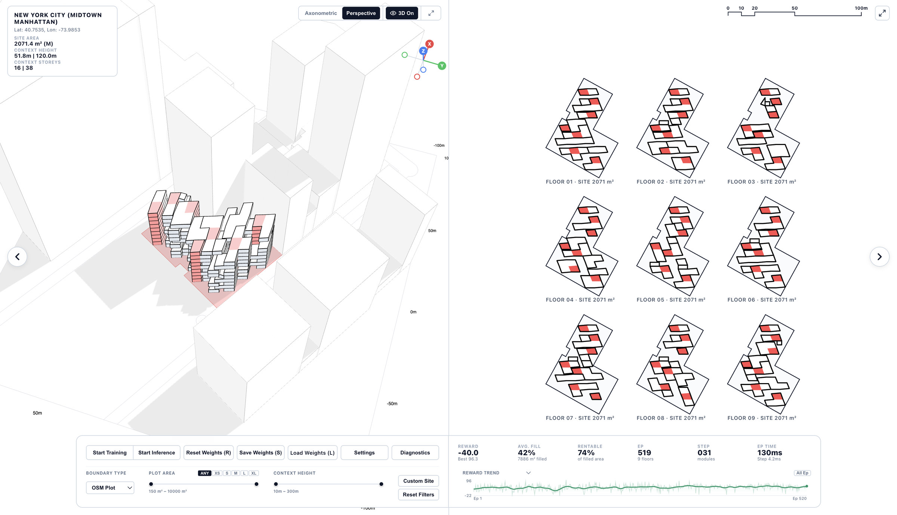
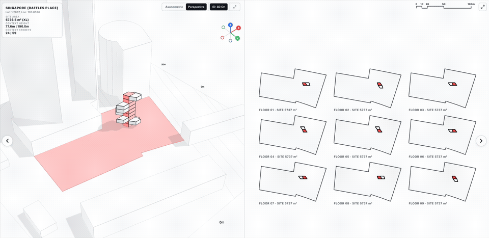
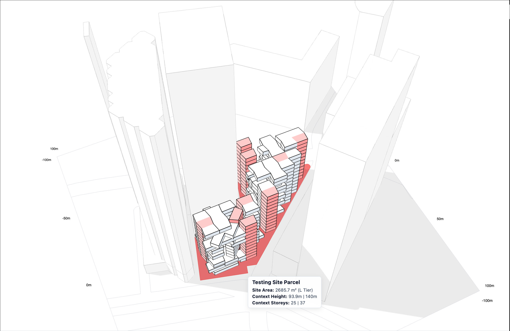
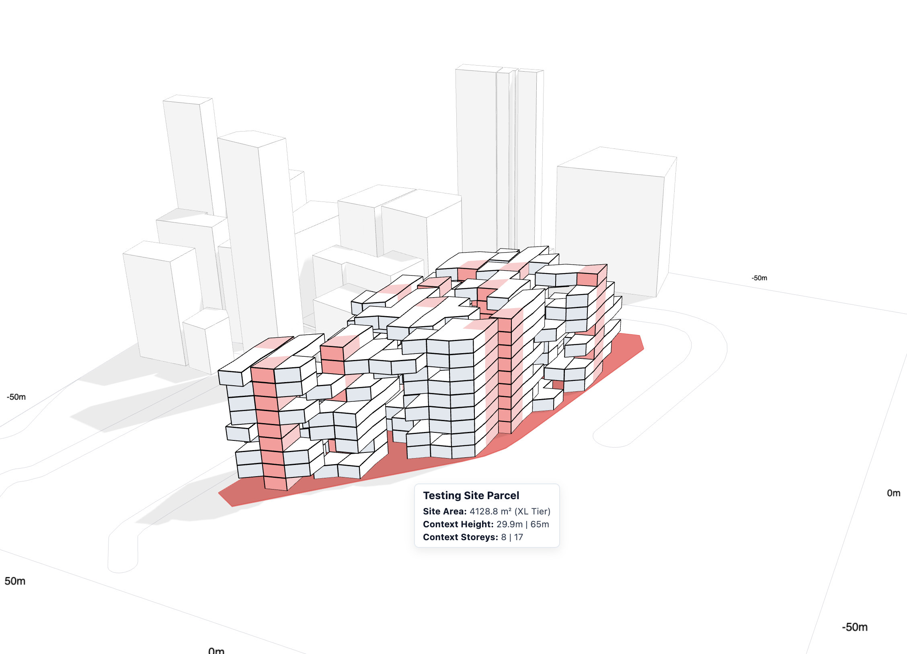
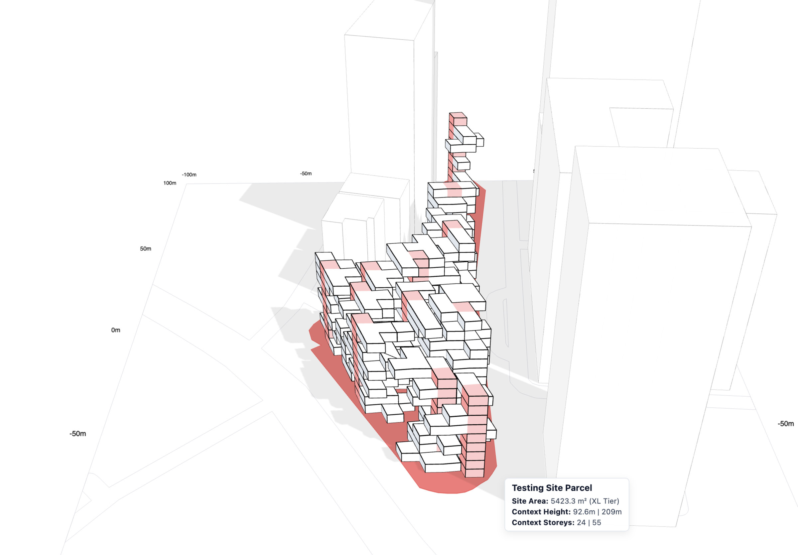
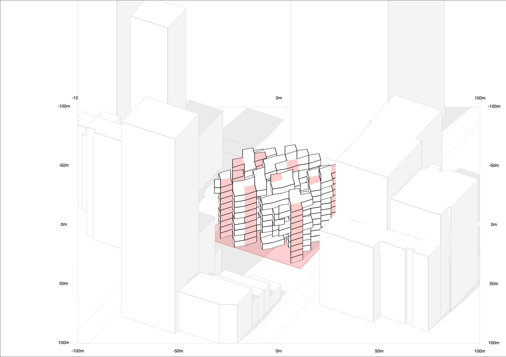
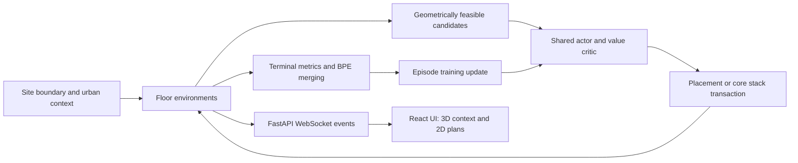
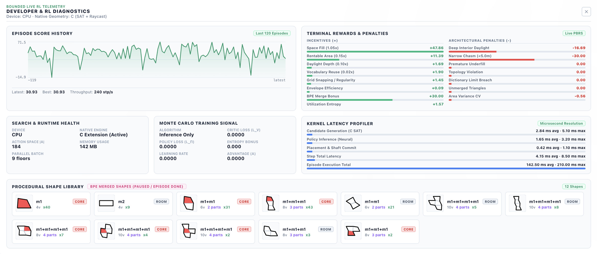

# Module Lab v0.9.0

**Reinforcement learning for modular building generation in urban context.**

Module Lab explores how a learned policy can assemble polygonal rooms and vertically aligned circulation cores inside a site boundary. A Python geometry engine checks candidate placements, a PyTorch actor–critic selects actions, and a browser interface shows the resulting massing, floor plans, and training telemetry.



[Demo](#demo) · [Showcase](#showcase) · [Quick start](#quick-start) · [Technical architecture](#technical-architecture) · [Training method](#training-method) · [Tests and benchmarks](#tests-and-benchmarks)

This README describes the **v0.9.0 release on `main`**. It is a research prototype for layout and massing exploration; its geometric checks and reward proxies do not constitute structural, egress-code, or environmental certification.

## Demo

[](docs/media/module-lab-demo.mp4)

**[Watch or download the full MP4 demo](docs/media/module-lab-demo.mp4)** · approximately 10 seconds. The preview and video come from the existing presentation recording.

## Showcase

| Urban massing | Alternative layout | Another site configuration |
| --- | --- | --- |
|  |  |  |

| Original generation | AI-edited material study |
| --- | --- |
|  |  |

The material study is a presentation visualization. The live application produces the polygonal geometry shown in the original generation and interface screenshots.

## Capabilities

- **Urban sites:** load parcel boundaries, surrounding building footprints/heights, and road geometry from the bundled OpenStreetMap-derived dataset; filter sites or request a custom location.
- **Learned geometry and placement:** sample a dictionary of triangular and quadrilateral modules, then score feasible placement candidates using relational attention.
- **Multi-floor core transactions:** choose one core module, rotation, and local anchor for every floor; validate the stack before committing it across the building.
- **Reusable layouts:** extract adjacency graphs and merge repeated neighboring modules using a BPE-inspired vocabulary procedure.
- **Interactive inspection:** compare a Three.js context view with 2D floor plans, reward history, and detailed runtime diagnostics.
- **Training and inference:** learn from episodes or generate with the current policy; save and load checkpoints and disable display geometry during training.

`parallelEnvironments` represents floor environments sharing one policy within a trainer. The v0.9.0 default is **9**, configurable from **1 to 16**. The project's standard multi-floor evaluation range is **4–8 stories**; the presentation screenshots also show a nine-floor configuration.

## Quick start

Use Python with a compatible PyTorch 2.6+ installation. A C11 compiler is needed for the optional native geometry library. Node.js/npm are needed to rebuild the React frontend.

```bash
git clone https://github.com/guzel-hairdressers/RL-Discrete-Building-Generator.git
cd RL-Discrete-Building-Generator
git switch main

python3 -m venv .venv
source .venv/bin/activate
python3 -m pip install -r requirements.txt
python3 src/c/build_native.py
python3 src/server.py
```

Open [localhost:8000](http://localhost:8000). Use **Start Training** to update the policy, or **Start Inference** to generate with its current weights. Set `PORT` to use another port.

A prebuilt frontend is committed in `frontend/dist/`. Rebuild it after changing `frontend/src/`:

```bash
cd frontend
npm ci
npm run build
```

The backend serves `frontend/dist/` when that directory exists, with a fallback to the legacy `public/` interface. This is a Python/WebSocket application: a static GitHub Pages deployment alone cannot run the trainer.

### Compute and native geometry

`MODULE_LAB_DEVICE=auto` selects CUDA when available, otherwise CPU. Explicit choices are `cpu`, `mps`, `cuda`, and `cuda:N`. Geometry and candidate generation remain on the CPU even when policy evaluation uses an accelerator.

```bash
MODULE_LAB_DEVICE=mps python3 src/server.py
MODULE_LAB_TORCH_THREADS=1 python3 src/server.py
MODULE_LAB_DISABLE_NATIVE_GEOMETRY=1 python3 src/server.py
```

The native build supports macOS (`libfast_geometry.dylib`) and Linux (`libfast_geometry.so`), verifies ABI version 3, and installs the library atomically. Set `CC` to choose a compiler; `--debug` builds with debug symbols and `--clean` removes the built library. Python geometry provides the fallback when the native library cannot be used.

## Technical architecture



| Component | Responsibility |
| --- | --- |
| [`src/server.py`](src/server.py) | `FloorEnvironment`, `ParallelTrainer`, policy/value networks, episode updates, checkpoints, HTTP routes, and WebSocket protocol |
| [`src/geometry.py`](src/geometry.py) | Polygon operations, site loading, candidate-search structures, and native library bindings |
| [`src/c/fast_geometry.c`](src/c/fast_geometry.c) | Native overlap, containment, and wall-clearance routines |
| [`src/graph.py`](src/graph.py) | Layout adjacency graphs, repeated-pair merging, and vocabulary extraction |
| [`frontend/src/store/useStore.js`](frontend/src/store/useStore.js) | Client settings, connection state, command dispatch, and event handling |
| [`frontend/src/components/`](frontend/src/components/) | Three.js renderer, plan canvas, controls, charts, and diagnostics |
| [`context_generator/`](context_generator/) | OSM context fetching and site preparation; see its own setup instructions |

### Geometry and vertical alignment

Vector polygons determine containment, overlap, shared walls, and perimeter. Raster cells accelerate candidate search and support sampling-based metrics. The daylight terms are geometric proxies, rather than a full radiance simulation.

Each WebSocket connection creates an isolated `ParallelTrainer`. Its floor environments share a model and optimizer. A core stack is a building-level action: the chosen transform must be valid on every participating floor. The stack is committed transactionally, with rollback checkpoints guarding partial changes. Independent room placements then grow each floor around the shared circulation.

The bundled dataset is `data/real_sites_dataset.json`; the loader also discovers custom site HTML files. Counts can change as sites are added, so the repository does not promise a fixed parcel count. Building-height and neighborhood context depend on the source data available for each site.

## Training method

The v0.9.0 implementation uses an **A2C-style actor–critic update** with generalized advantage estimation (GAE). Placement actions use importance-weighted REINFORCE to account for the behavior policy; shape decisions use a site-level value baseline. It does not implement a conventional multi-epoch PPO training loop.

- **Actor:** a relational Set Transformer scores a variable-size candidate set from 22-dimensional placement features, positions, and angles. The release uses hidden width 64, four attention heads, and two layers. Separate heads handle module category, shape parameters, and atrium decisions.
- **Critic:** `DynamicValueCritic` estimates the normalized return using site encoding, placed geometry, and macro-state features. Floor encodings are pooled using their mean and maximum.
- **Returns:** terminal scores are divided by 100; GAE uses `gamma = 0.99` and `lambda = 0.95`, with intermediate potential-based reward shaping.
- **Update:** actor loss plus `0.5 × smooth-L1 value loss`, minus `0.01 × normalized entropy`; gradient norm is clipped to 2.0. An episode with no differentiable decisions skips the optimizer step.
- **Defaults:** learning rate `0.001`, constant schedule, `bufferEpisodes = 1`, and `ratioClip = 0.0`. Optional linear/cosine schedules and importance-ratio clipping are exposed as settings.

The reward combines fill and rentable-area terms with daylight-depth proxies, circulation/topology checks, module reuse, and shape/merge penalties. Its score measures the configured objective; a higher score does not establish architectural quality or convergence across unseen sites.

### Episode flow

1. Load or sample a site and create its floor environments.
2. Synthesize the module dictionary and evaluate shared core-stack candidates.
3. Score feasible actions, commit selected placements, and retain decision data.
4. Compute terminal geometry metrics and extract/merge repeated layout patterns.
5. Update actor and critic in training mode, publish the completed episode, and prepare the next one.

## WebSocket interface

The browser connects to **`/ws`**. Messages are JSON objects with a string `cmd`; responses use a `type` field. `generationId` and `episode` identify the current state and protect step/evaluation requests from stale client state.

| Command | Purpose |
| --- | --- |
| `getState` | Request the current trainer state |
| `updateSettings` | Apply a `settings` object and prepare the corresponding generation |
| `newSite` / `setSite` | Sample another site or select a specific one |
| `step` / `evaluate` | Advance or evaluate the identified generation and episode |
| `setMode` | Switch between `training` and `inference` |
| `setVisuals` | Enable or disable display-geometry payloads |
| `saveCheckpoint` / `loadCheckpoint` | Save on the server or load base64 checkpoint data |
| `resetPolicy` | Reinitialize the policy |

For example, after reading the current identifiers from the server:

```json
{"cmd":"step","generationId":1,"episode":0}
```

`site`, `placements`, and `episodeDone` events include a `coreStacking` audit with alignment results and violations. Checkpoint uploads have a 64 MiB limit, require a compatible PyTorch runtime, and validate state before committing it.

### Diagnostics and visuals off



Open diagnostics with **Ctrl+Shift+D / Cmd+Shift+D**. The panel exposes reward components, candidate counts, geometry backend state, memory, and policy/value training telemetry. The image above is a presentation capture, not a benchmark result.

The **3D Off** control stops rendering and omits display geometry from training payloads while retaining the training computation. Inference and trajectory recording can still require complete geometry at episode completion. See the [visuals-off implementation guide](agent_notes/guides/visuals_off_guide.md) for protocol details and recorded comparisons.

## Tests and benchmarks

```bash
python3 src/c/build_native.py
python3 -m unittest discover -s tests -p "test_*.py"
```

Tests cover geometry/native parity, core stacking, policy invariance, checkpoint handling, frontend/protocol contracts, and training behavior. Use the output from the checked-out revision for test totals and skips.

The project uses two separate benchmark protocols:

| Evaluation | Required workload | Command |
| --- | --- | --- |
| Speed and throughput | High-density `L`/`XL` sites, 120 max modules/floor, 4–8 floors; the reference workload uses 480 modules across four floors | `PYTHONPATH=src python3 benchmarks/benchmark_head_to_head_comparison.py` |
| Quality and learning | Site Area Tier `ANY`, Boundary `FREE`, auto-changing sites | `PYTHONPATH=src python3 benchmarks/benchmark_750_episodes_convergence_any.py` |

Do not substitute 25-module toy workloads for throughput results. Performance depends on site geometry, device, native backend, and settings; recorded runs live in [the benchmark archive](agent_notes/benchmarks/).

## Further documentation

- [Agent notes index](agent_notes/README.md)
- [Core stacking guide](agent_notes/guides/core_stacking_guide.md)
- [BPE merging guide](agent_notes/guides/bpe_merge_guide.md)
- [Benchmarking guide](agent_notes/guides/benchmarking_guide.md)
- [Context Generator setup](context_generator/README.md)
- [Roadmap](agent_notes/roadmap.md), [issues](agent_notes/issues.md), and [implementation history](agent_notes/historical_approaches.md)
- [Showcase media sources](docs/media/README.md)
