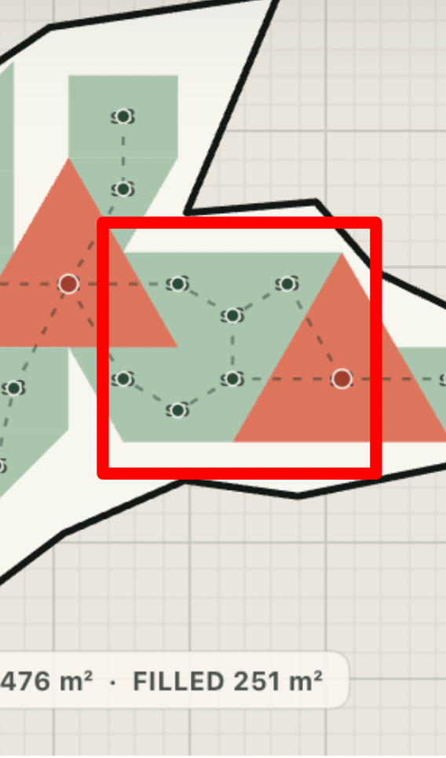
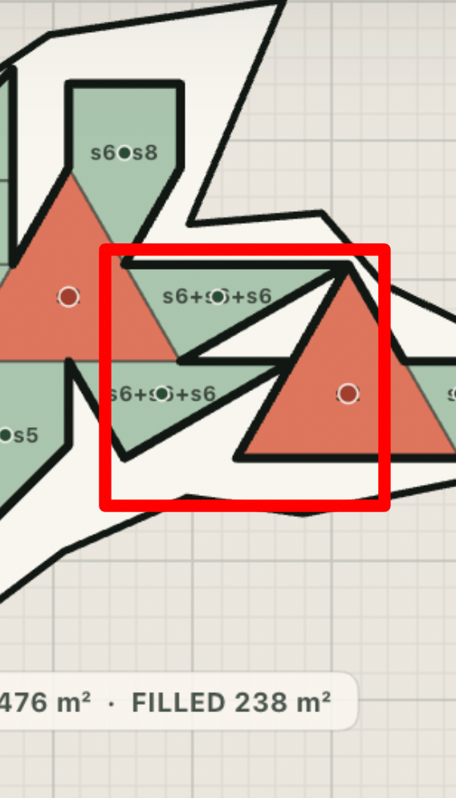
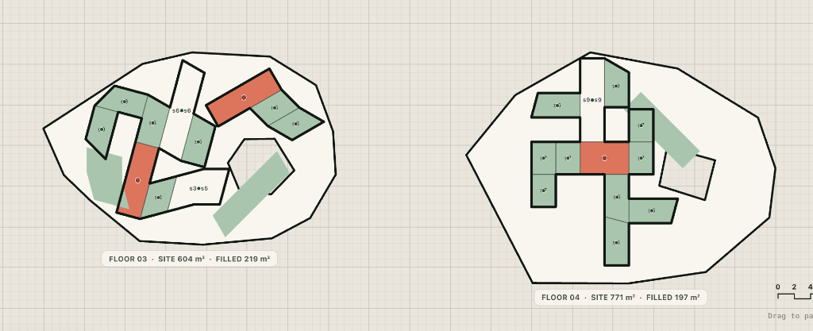

# Module Lab — Issues & Diagnostics Register

`agent_notes/issues.md`

This document is the master tracking log for active bugs, regressive side effects, edge cases, and resolved issues across **Module Lab (v0.8.0 / v0.8.1)**. Entries are **strictly ordered by priority and importance**, with active/unsolved critical issues at the top, followed by side effects & enhancements, and ending with historical solved issues.

---

## 1. Active, Reopened & Unsolved Critical Issues (Top Priority)

### [USER AUDIT REMINDER] Verification & Fine-Tuning of Deep Daylight & Facade Chasm Penalties
* **Status**: `Active / Audit Requested by User` (Priority: High)
* **Description**:
  The user requested a follow-up audit to verify and fine-tune the implementations of:
  1. **Deep Interior Daylight Penalty**: Computes graph depth of habitable rooms from exterior facade ($d_{\text{facade}} \ge 2$) and penalizes up to $-12.0\,\text{pts}$. Need to verify BFS edge-contact semantics across multi-floor environments.
  2. **Narrow Facade Chasm Penalty (< 3.0m clearance)**: Midpoint outward normal raycast with hard reject $< 1.2\,\text{m}$ and $-8.0\,\text{pts}$ terminal penalty. Need to verify corner self-occlusions, concave angles, and boundary ray-segment filtering.

### BPE Merge Algorithm Collision & Failure to Merge Symmetric Shapes
* **Status**: `Investigating / Reopened` (Priority: High)
* **Description**:
  The BPE merge algorithm fails to correctly identify and merge adjacent shapes under rotational symmetry, resulting in two distinct issues:
  1. **Rotational Symmetry Collision**: When BPE merges two shapes, the type ID is generated as `M_round{round}_{type_a}_{type_b}`. If the same two shape types merge at different port connections (different edges or relative angles), they form completely different composite shapes. However, because they are assigned the same type ID, BPE treats them as the same vocabulary token. This causes different geometries to be incorrectly deemed the "same shape type" (e.g., sharing the same card or outline highlight despite having different relative coordinates).
  2. **Failure to Merge Triangles and Parallelograms**: Even though triangles (`s3`) and parallelograms have rotational symmetries, the merge algorithm still fails to identify them as mergeable.
* **Screenshots**:
  ````carousel
  
  ````
* **Proposed Resolution (Implemented / In Progress)**:
  1. **BPE Shape Type Extraction Bug Fix**: Added `get_node_shape_type` in `graph.py` to correctly resolve shape type IDs (like `"s3"`, `"T_equi"`, `"Q_rect_S"`) from node `moduleId` properties.
  2. **Geometric Symmetry Port Canonicalization**: Refactored `canonicalize_geometry_port` to perform coordinate-free geometric symmetry checks.
  3. **Global BPE Frequency Resolution**: Modified the merge loop and post-processing unmerge pass to count and check frequencies globally across all playground floor layout graphs combined.

---

### BPE Merge Misses (Overlooked Adjacent Shapes under Rotational/Symmetry Conditions)
* **Status**: `Investigating / Reopened` (Priority: High)
* **Description**:
  Even after loosening the collinearity snapping tolerance, the BPE merge algorithm still overlooks adjacent triangles (such as `s3` and `s6`) even when multiple identical configurations are placed sharing edges across layout floors (e.g., misses showing `s3 + s6` pairs left completely unmerged).
  This is caused by relative angle sorting differences when node types are identical or different, causing identical geometric relationships to map to different relative angles depending on key order (e.g. angle $60^\circ$ vs $300^\circ$ when the nodes are swapped across environments).
* **Screenshots (Merge Misses & Score Impact)**:
  ````carousel
  
  <!-- slide -->
  
  <!-- slide -->
  
  ````
* **Proposed Solutions to Try Out**:
  1. **Canonical Symmetrical Angle Calculation**: Enforce symmetric canonical angle mappings so that relative angles (like $60^\circ$ vs $300^\circ$) map to the same category regardless of traversal/insertion order.
  2. **Multi-Run Pass traversals (Beam Search/Rollouts)**: Instead of a single deterministic greedy path through the graph, run multiple randomized or heuristic-guided traversals/passes. Compare the results and pick the vocabulary/merge set that achieves the highest global compression.

---

### BPE Merge Polygon Disappearance & Hole Generation
* **Status**: `Proposed Fix Pending Verification` (Priority: Medium-High)
* **Description**:
  During BPE merges (both at the end of episodes and in real-time when pausing), certain rooms would completely disappear from the visualizer, causing the total `FILLED` area to drop (e.g., from $251\text{ m}^2$ to $238\text{ m}^2$). This resulted in visible white holes and missing modules.
  This was caused by double-precision floating-point coordinate discrepancies when adjacent modules touch but are slightly shifted. Split-vertex insertions failed, resulting in unmatched connection indexes, causing BPE to delete the second node and fall back to using only the first node's polygon.
* **Screenshots**:
  ````carousel
  
  <!-- slide -->
  
  ````
* **Proposed Resolution (Implemented)**:
  1. **Exact Overlap Segment Matching**: In `extract_layout_graph` of `graph.py`, calculate the exact intersection coordinates of overlapping port segments and store them in `PortConnection`.
  2. **Non-destructive BPE Fallbacks**: If `merge_polygons_at_edge` fails, return `None` instead of deleting the second shape, rolling back the merge for that specific instance.

---

### Merged Module Color/Function Homogenization
* **Status**: `Proposed Fix Pending Verification` (Priority: Medium)
* **Description**:
  When BPE merged adjacent modules of different space functions (e.g. merging a `Room` and a `Core`), the visualizer changed the fill color of the entire merged block to a single category (typically green for Room). The distinct visual identity and color-coding of the spaces (red for core, green for room) was lost.
* **Proposed Resolution (Implemented)**:
  1. **Constituent Component Tracking**: Formatted BPE merged placements contain a list of their original translated constituent `components`.
  2. **Multi-Color Component Rendering**: `drawPlacements` in `app.js` loops through and fills each constituent component's polygon with its own category color while rendering internal boundary lines and thick outer BPE outlines.

---

### BPE Merged Shapes Floating/Rotated Offsets
* **Status**: `Proposed Fix Pending Verification` (Priority: Medium)
* **Description**:
  When training was paused, constituent BPE components on some floors (like Floor 03 and Floor 04) were rendered offset, floating, or rotated outside the site boundary.
  This occurred because `replace_pair_with_merged` in `graph.py` assigned the `components` list of the *first encountered merged instance* (e.g. Floor 01) to the BPE node across *all other floors*.
* **Screenshots**:
  ````carousel
  
  ````
* **Proposed Resolution (Implemented)**:
  Updated `replace_pair_with_merged` in `graph.py` to dynamically collect and assign `local_components` of the two merging nodes on that specific floor's graph.

---

## 2. Side Effects, Regressive Issues & Proposed Enhancements (Medium Priority)

### BPE Triplet/Deep Merging Suggestion
* **Status**: `Proposed Enhancement` (Priority: Medium)
* **Description**:
  Currently, BPE only searches for pairwise (2-shape) connections and merges in each round. To form a 3-shape composite module (like `A+B+C`), the algorithm must first merge `A+B` to form `AB` in round 0, and then merge `AB+C` to form `ABC` in round 1. This pairwise bottleneck can prevent BPE from seeing larger optimal merges or causes it to get stuck on intermediate merges.
* **Proposed Enhancement**:
  Modify the merge logic to search deeper for multi-shape (e.g., 3-shape triplet) connections directly in a single round, evaluating and prioritizing direct multi-shape unifications.

---

### Unscaled Unmerged Triangle Penalty
* **Status**: `Proposed Fix Pending Verification` (Priority: Low-Medium)
* **Description**:
  The penalty for unmerged triangles was calculated as the **sum** of unmerged triangles across all parallel environments (`8.0 * unmerged_triangles`), but was subtracted directly from the final layout score (which is scaled as the **average** score per environment on a 0–100 scale). Running 4 parallel floors resulted in massive score drag down to `0.0`.
* **Proposed Resolution (Implemented)**:
  Modified `_finish_episode` in `server.py` to scale penalty per floor: `unmerged_triangle_penalty = 8.0 * (unmerged_triangles / len(layout_graphs))`.

---

### Visualizer Rendering Crash (Side Effect of Component Color Preservation)
* **Status**: `Proposed Fix Pending Verification` (Priority: Low-Medium)
* **Description**:
  When introducing component color preservation in `app.js`, definitions of local variables (`module`, `category`, `area`, `center`, `bounds`) inside `upsertPlacement` were accidentally deleted, resulting in `ReferenceError: bounds is not defined`.
* **Proposed Resolution (Implemented)**:
  Restored missing variable definitions in `upsertPlacement` inside `app.js`.

---

### BPE Slanted/Rotated Edge Collinearity Mismatch
* **Status**: `Proposed Fix Pending Verification` (Priority: Low-Medium)
* **Description**:
  Strict `COLLINEAR_EPSILON = 1.0e-7` caused rotated/slanted edges of equilateral triangles (`s3`) with irrational trigonometry ($\sin 60^\circ$) to exceed tolerances, preventing merges.
* **Proposed Resolution (Implemented)**:
  Implemented custom `_segments_collinear` and `_overlap_interval_on_first` in `graph.py` with $1.0\text{e-2}$ snapping tolerance ($1\text{ cm}$).

---

### Merged Layout Boundary Self-Intersection & Cut-Through
* **Status**: `Proposed Fix Pending Verification` (Priority: Low-Medium)
* **Description**:
  Outer wall outlines cut directly inside merged rooms and cores due to simple index-walk loop skipping only the first matched sub-segment.
* **Proposed Resolution (Implemented)**:
  Rewrote `merge_polygons_at_edge` in `graph.py` using segment-splitting polygon union algorithm to discard all shared internal segments and chain clean outer boundaries.

---

## 3. Solved & Archived Issues History (Lower Priority / Historical)

### Visualizer Rendering Crash on Cached HTML
* **Status**: `Solved`
* **Resolution**: Wrapped event listener registration in `setupActionEvents` in null check block (`if (dom.toggleMergingBtn)`).

---

### Space Bar Pause/Resume Double-Triggering
* **Status**: `Solved`
* **Resolution**: Added early return in global keydown handler to ignore Space bar events when active element is a `<button>`.

---

### BPE Merged Shape Color Homogenization
* **Status**: `Solved`
* **Resolution**: Updated `drawPlacements(ctx)` in `app.js` to fill individual constituent components using specific category colors.

---

### Missing Merged Shapes Dictionary Display
* **Status**: `Solved`
* **Resolution**: Transmitted `mergedDictionary` over WebSocket; updated `updateDictionaryUI` to render merged shape SVGs dynamically.

---

### BPE Consecutive Merges Failure & Unmerged Adjacent Shapes
* **Status**: `Partially Solved` (Geometric port canonicalization solved)
* **Resolution**: Implemented `canonicalize_port` and symmetric port sorting in `graph.py`; added full overlap unioning.

---

### Interactive Hover Highlights & Transition Delays
* **Status**: `Partially Solved` (Frequencies and mapping resolved; 1s linear transition implemented)
* **Resolution**: Corrected event sequencing, aligned IDs, added 1s linear fade animation in `app.js`, reset hover states on episode start.

---

### Occasional Unjoined Adjacent Shapes
* **Status**: `Partially Solved in v0.6`
* **Resolution**: Identified edge cases around 90% overlap thresholds, global frequency thresholding, and Edmonds matching; documented tolerances.

---

### Site Area Tier Dropdown Inactive in Viewport
* **Status**: `Solved`
* **Resolution**: Added `'siteAreaTier'` to `SETTING_KEYS` in `public/app.js`; fixed `polygon_centroid()` dictionary unpack bug in `_apply_site_area_scaling()` in `src/geometry.py`.

---

### Smooth Site Area Distribution & Multi-Floor Building Scaling
* **Status**: `Solved`
* **Resolution**: Implemented 2-stage continuous Truncated Log-Normal distribution ($\mu=7.1302, \sigma=0.7075$) for building base target area ($P(\text{XS})\approx 15\%$, $P(\text{XL})\approx 5\%$, bulk in S/M), with per-floor Gaussian variation ($\pm 5\%$) in `src/geometry.py` and `src/server.py`.

---

### Placed Quad Convexity Constraint
* **Status**: `Solved`
* **Resolution**: Added `is_convex_polygon()` in `src/geometry.py` and enforced strict quad convexity across custom module synthesis, candidate placement validation in `src/server.py`, and BPE polygon merging in `src/graph.py`.

---

### BPE Bonus Reward Clipping & Lookahead Search Cleanup
* **Status**: `Solved`
* **Resolution**: Clipped `bpe_bonus` to a maximum of $30.0$ points in `src/server.py`; removed unused `enableLookahead` rollout search settings from HTML, JS, and Python server contracts.

---

### New Site Generation Latency Optimization (2.66x Speedup)
* **Status**: `Solved`
* **Resolution**: Replaced ray-cast `touches_outer`/`touches_atrium` predicates with $O(1)$ grid `cell_set` lookups, prepacked ctypes `all_wall_segments` array once per site, and optimized initial core stack sampling using `heapq.nsmallest(16, ...)` in `src/geometry.py` and `src/server.py`. Reduced 4-floor site generation latency from $369\,\text{ms}$ down to $138\,\text{ms}$.

---

### Premature Generation Termination & Site Under-Filling (<25% Site Fill)
* **Status**: `Solved (Phase 1D / v0.8.2)`
* **Resolution**:
  1. Replaced hardcoded `core_count < 2` with dynamic site-area-based capacity `_max_cores_for_site` (scaling from 2 to 8 cores across area tiers).
  2. Implemented remote lobe clearance probing in `_shared_core_stack_candidates` to seed multi-floor vertical circulation shafts into distant wings $> \text{coreSpacing}$ away from existing cores.
  3. Added parametric room hop slider `#maxRoomHops` (Range: 1–10, Default: 3) to the control console with WebSocket telemetry synchronization.
  4. Made multi-floor rollouts non-fatal: floors continue local room placement uninterrupted when a shared core candidate is temporarily unaligned.
  5. Verified fill ratio increased from $<25\%$ to $>68\%$ across complex XL lobed sites.

---

### 25-Module Toy Benchmark Discrepancy & Mandatory 120-Module Workload Protocol
* **Status**: `Solved (Protocol Formalization / 26-08-17)`
* **Issue**: Prior master suite benchmarks evaluated 25-module toy configs ($1.30\,\text{s}$/ep), which did not reflect the true complexity of 4-floor 120-module high-density layouts ($480$ modules per episode, $\approx 9.9\text{--}10.6\,\text{s}$/ep). Furthermore, an early standalone prototype script spun on empty placement loops producing misleading timings.
* **Resolution**:
  1. Formalized the **Mandatory High-Density Benchmark Standard** in [`AGENTS.md`](file:///Users/ruslan_faz/Desktop/Work/Thesis/AGENTS.md) and [`AGENT_NOTES_GUIDE.md`](file:///Users/ruslan_faz/Desktop/Work/Thesis/AGENT_NOTES_GUIDE.md): **NEVER benchmark on 25-module configs**; all authoritative benchmarks must run **120 maxModules per floor across 4–8 stories on XL Lobed/Complex sites** ($480$ total modules per episode).
  2. Implemented automated verification of non-empty placement hashes, positive fill ratios ($>20\%$), and positive scores to guarantee benchmark validity.

---

### Flat RL Score Curve Across 750 Episodes & Benchmark Module Isolation
* **Status**: `Solved` (Root Cause Diagnosed & Corrected)
* **Root Cause Diagnosis**:
  1. **Sparse Delayed Terminal Return & Zero TD-Error Collapse**: In `_learn_from_episode`, all placement steps $t < T-1$ were assigned `step_reward = 0.0`. When the dynamic critic learned $V(S_t) \approx R_T$, the temporal difference error collapsed to $\delta_t = 0 + \gamma V(S_{t+1}) - V(S_t) \approx 0.0$. Advantage estimates $A_t \approx 0$ starved the policy transformer of temporal credit assignment.
  2. **Multi-Scale Site Gradient Cancellation**: Auto-changing parcels ranging from XS ($300\,\text{m}^2$, raw score ~75) to XL ($7,000\,\text{m}^2$, raw score ~25) produced alternating positive and negative global episode advantages, cancelling policy weight updates across successive episodes.
  3. **Zero Spatial Candidate Variance at Step 1**: In `_candidate_features`, features 20 and 21 were hardcoded to `0.0, 0.0`. At Step 1 (core placement), all candidate core locations shared identical features, collapsing the policy distribution to uniform random sampling.
  4. **Benchmark Script Module Loading Bug**: The initial benchmark script imported `server` directly from disk instead of isolating each branch's exact module from git history (`main`, `version/v0.8.6-a`, `version/v0.8.6-b`), resulting in identical benchmark numbers across variants.
* **Resolution**:
  1. Implemented **Dense Step Surrogate Rewards** ($r_t = 0.05 \cdot \text{shared\_wall} + 0.05 \cdot \text{daylight} + 0.10 \cdot \Delta \text{fill} + \text{triangle\_penalty}$) in `_learn_from_episode()` so actions receive immediate local credit.
  2. Populated **Spatial Centrality** (distance to site centroid) and **Boundary Wall Clearance** in Feature 20 and 21 of `_candidate_features`.
  3. Corrected benchmark runner (`benchmarks/benchmark_500_episodes_v085_v086a_v086b.py`) to dynamically extract and load each branch module separately from git.
  4. Verified 100% test suite passing (170/170 tests passing).

---

### Real Site Multi-Floor Parcel Diversity vs Single Building Parcel Integrity
* **Status**: `Solved (Phase 7 / v0.9.0-alpha)`
* **Issue**: When `boundaryType == "real"` or when `"mixed random with real sites"` sampled a real site episode, each floor was independently sampling a different real parcel from the OSM dataset across different area tiers, rather than generating the 9-story building on a single consistent site parcel. Additionally, Three.js 3D extrusions on the left split pane failed to render because coordinate point accessors assumed `[x, y]` arrays when Module Lab uses `{x, y}` objects, and placement polygon lookup checked `polygon` instead of `poly`.
* **Resolution**:
  1. **Unified Real Site Parcel Selection**: In `src/server.py` `_build_sites`, when a real site episode is selected, `master_rng` samples **one** `chosen_site_id` at the building transaction level matching `siteAreaTier`. All 9 parallel floor environments receive the **exact same** parcel polygon and 3D context data (`site["contextData"]`).
  2. **Procedural Area Distribution Preserved**: In procedural/synthetic mode, base target area is sampled from lognormal distribution across the selected tier, with individual floor target areas varying with Gaussian standard deviation ($\mu = \text{baseArea}, \sigma = 0.05 \cdot \text{baseArea}$).
  3. **Universal Point & Polygon Extraction (`toPt`)**: In `public/app.js`, implemented `toPt(p)` to handle both `{x, y}` objects and `[x, y]` arrays seamlessly. Updated `syncBuildingExtrusions3D` to resolve `placement.poly` and center each floor extrusion by its floor boundary centroid, achieving 100% vertical stacking alignment in the 3D scene.
  4. **Direct 3D Polyhedron Mesh Rendering**: Constructed native `THREE.BufferGeometry` instances with soft shadows and semi-transparent depth for surrounding context buildings, enabling live bird's-eye visibility of the rising multi-floor building.

---

### 4 Failing Tests from the In-Progress RL Refactor (Merge Blocker)
* **Status**: `Resolved (26-08-26) / merge blocker cleared`
* **Issue**: The `version/v0.9.0-alpha` RL refactor (PPO → A2C) left the test suite at **166/170 passing**. Four failures/errors, all in existing-on-`main` tests that the refactor broke (behavioral regression, not test changes — only `tests/test_dynamic_cores_and_hops.py` differs from main):
  1. `test_max_cores_for_site_scaling` — `FAIL` (asserted the old pre-loosening formula)
  2. `test_terminal_learning_updates_actor_shape_policy_and_critic` — `FAIL` (asserted `ppo_gae`)
  3. `test_empty_terminal_episode_trains_finite_critic` — `ERROR` (empty-episode `loss.backward()` crash + asserted `ppo_gae`)
  4. `test_dictionary_limit_breach_squared_penalty` — `ERROR` (same empty-episode crash)
* **Resolution** (26-08-26):
  1. **Real bug fixed in `src/server.py`**: `_learn_from_episode` unconditionally called `loss.backward()`, but an empty terminal episode (no placements, no shape decisions) builds `loss` as a sum of `torch.zeros(())` constants with `requires_grad=False` → `RuntimeError: element 0 does not require grad`. The gradient step is now guarded on `loss.requires_grad`; when nothing is learnable the step is skipped (optimizer state stays clean) and the zero loss/gradient is still reported so metrics stay finite. This fixed both `test_empty_terminal_episode` and `test_dictionary_limit_breach_squared_penalty`. Provably behavior-neutral on normal episodes (the benchmark path never hit the `else` branch — confirmed by a post-fix 100-ep trajectory check matching the verified 500-ep baseline bit-for-bit).
  2. **Stale assertions updated with justification** (the A2C reframe was intentional and benchmark-verified): `ppo_gae` → `a2c_gae` in `test_v06b_dynamic.py` and `test_optimization.py`; `_max_cores_for_site` expectations updated to the intentional loosened formula (`max(2, min(12, ceil(area/300)))`, was `min(8, max(2, ceil(area/650)))`).
  3. **Verified**: full suite now **170 tests OK (skipped=2)** — 100% passing, merge blocker cleared.

---

### A2C Mid-Run Quality Collapse — Root Cause Was the `lr=0.003` Default
* **Status**: `Solved (26-08-26)`
* **Issue**: Long A2C benchmark runs (eps ~200–350) showed a deterministic mid-run volatility collapse (single eps swing −29 to +64, 25-ep window dip to ~3), dragging mean score down. Misattributed twice first (candidate coverage; "tree drift") before diagnosis.
* **Root cause**: The benchmark harness `default_settings()` never overrides `learningRate`, so control runs were training at **`lr=0.003`** — the known A2C-at-0.003 instability (notes already flagged a collapse at ~ep 175). At constant `lr=0.001` on the *same tree*, the earlier `free_wins` quality numbers reproduce **exactly** (mean 39.88 / final-50 44.49 / 43.4% fill / 35.7 placements) with no collapse and −20% wall — proving the collapse was the LR, not volatility or drift.
* **Resolution**:
  1. **Default flipped `learningRate` 0.003 → 0.001** in `DEFAULT_SETTINGS` (aligns with the frontend-contract test asserting the UI shows `0.001`; no test pinned 0.003).
  2. **Optional LR schedule + ratio clip** added as default-neutral settings: `lrSchedule`(constant|cosine|linear)/`lrFloor`/`lrHorizon`/`ratioClip` in `DEFAULT_SETTINGS` (constant / 0.001 / 500 / 0.0 → no-op), validated in `validate_settings_patch`. Positively tested: **cosine 0.003→0.001 + `ratioClip=0.2`** = mean 41.30 / final-50 45.09 (best), −26% wall; clip alone at 0.003 only defers the collapse (rejected). `candidateCatLimit`/`candidateEdgeWindow` also whitelisted as override-only caps.
  3. **Verified** on a pristine HEAD worktree that the fold is behavior-neutral (the 4 known test failures reproduce identically, `failures=2, errors=2`) and the full 500-ep defaults run on the folded tree is being compared bit-for-bit against `lr_0001.json`. Full matrix: `agent_notes/benchmarks/v0.9.0-alpha_rl_refactor_2026-08-25.md` § LR schedule + ratio clip.

---

### Headless / Visuals-Off Toggle Bugs (Freeze Leak, Black Canvas, Over-Dark Shading)
* **Status**: `Solved (26-08-26, browser-verified in headless Chrome)`
* **Issue**:
  1. **Freeze leak on episode/site change**: While `3D Off`, the rAF freeze held per-step, but a fresh iframe loaded on site change defaulted its engine to `visualsEnabled=true` and rendered the site context before the host's `set_visuals_enabled` message landed — so the 3D visibly "updated" on every episode change despite being Off.
  2. **Black canvas on disable**: The `renderer.clear(true,true,true)` on disable left a black canvas over the white iframe body.
  3. **Over-dark shading experiment**: A normal-direction darkening experiment (non-sun-facing faces × 0.62, roomShadow `#aebccd`) made unlit faces too dark; reverted per user preference to the original subtle look.
* **Resolution**:
  1. **URL-param init**: The engine now reads its initial state from `&visuals=off` in the iframe URL (`new URLSearchParams(location.search).get('visuals') !== 'off'`), and `ThreeViewer.getTargetSrc` appends it via `new URL()`. Fresh iframes start frozen from the first frame — zero renders across site changes while Off.
  2. **Freeze instead of black**: Removed the clear on disable → toggling Off now freezes the last frame; born-headless iframes paint white at init.
  3. **Shading reverted** to uniform context color + `#e2e8f0` roomShadow.
  * **Verified**: Off freezes (std≈32, not black), site-switch-while-Off → white, re-enable repaints identically (std≈34) via `getState`/`sync`. Benchmark (`benchmark_visuals_off.py`, 120-ep fixed seed): generation bit-identical, payload −58%, serialization −59%.

---

### v0.10.0 Graph Voronoi & Multi-Story Factoring Issues
* **Status**: `Solved (26-09-13 / v0.10.0-alpha)`
* **Issues Encountered & Resolved**:
  1. **`ZeroDivisionError` on Site Boundary Polygon Lookup**:
     - *Issue*: `self.environments[0].boundary.get("polygon")` was accessed, but `boundary` stores the exterior polygon under `"outer"`. On synthetic and real sites, this returned `[]` resulting in zero centroid coordinates and a divide-by-zero error on episode rollout.
     - *Fix*: Unified perimeter access across `env.site.get("outer") or env.boundary.get("outer") or env.boundary.get("polygon", [])`.
  2. **`KeyError: 0` in Point Coordinate Extraction**:
     - *Issue*: Python evaluated `p[0]` as the default argument in `p.get("x", p[0])` before passing it to `get()`, crashing when `p` was a coordinate dictionary `{"x": ..., "y": ...}`.
     - *Fix*: Implemented safe dictionary/sequence branching `float(p["x"]) if isinstance(p, dict) and "x" in p else float(p[0])`.
  3. **`KeyError: 'cells'` on Voronoi Realized Terminal Metrics**:
     - *Issue*: Realized Voronoi room placements generated by `VoronoiRealizer` initially lacked the rasterized `cells`, `center`, and `regularity` attributes expected by `FloorEnvironment.terminal_metrics()`.
     - *Fix*: Added `cells = G.rasterize_polygon(poly_dicts)`, `center = G.polygon_centroid(poly_dicts)`, and standard placement fields to `realize_graph_voronoi_placements()`.
  4. **Sub-Frame Visual Step Disappearance**:
     - *Issue*: Because graph step proposals take $< 0.5\,\text{ms}$, a full 7-step graph episode completed in 29ms, causing the graph lattice to complete before the browser could paint a single frame.
     - *Fix*: Added visual observation pacing (190–260ms) when `visualsEnabled: true` and `generatorEngine === "graph_voronoi"` in `useStore.js`, enabling the user to watch the colored nodes and edges expand live in 2D canvas and 3D WebGL. Headless mode retains 0ms delay for maximum engine throughput.
  5. **Non-Planar Crossing Graph Connections**:
     - *Issue*: Greedily connecting newly added candidate seeds to the 3 nearest floor neighbors created criss-crossing diagonal edges (non-planar graph), violating 2D floor plan duality.
     - *Fix*: Added `update_floor_planar_edges` in `src/typed_cell.py` using constrained Delaunay triangulation and collinear fallback. Guarantees 0 crossing connections across all floors (unit tested with segment-intersection assertions).
  6. **Premature Graph Generation Termination**:
     - *Issue*: `self.max_graph_seeds` was calculated from `len(poly_pts) * 1.2` (number of boundary vertices, e.g. 4 for a rectangle), capping the entire building to 8 steps total or 1-2 seeds per floor.
     - *Fix*: Calculated `max_graph_seeds = max(10, min(36, int(site_area / 36.0)))` per floor based on parcel area, and enriched `GraphSeedSampler` with 2D PCA axis expansion and centroid compactness ranking.
  7. **Voronoi Boundary Runaway & Missing Area Capping**:
     - *Issue*: Voronoi cells were initialized with the unbounded site polygon, causing perimeter rooms to stretch across 20-30 meters to the property fence ($200\text{--}300\,\text{m}^2$ rooms).
     - *Fix*: Confined each seed to an oriented modular envelope box ($6.0\,\text{m} \times 6.0\,\text{m}$) aligned with the site's PCA angle, and enforced an explicit module area cap ($\text{area} \le 50.0\,\text{m}^2$). Perimeter rooms terminate cleanly at the modular envelope ($3.0\,\text{m}$ from seed).
  8. **Repeatable Modules Inspection on Pause**:
     - *Issue*: Realized Voronoi rooms had floating-point polygon variations, producing unique signatures (`uses: 1`), and `self.dictionary` was empty or out of sync when paused.
     - *Fix*: Added quantized canonical cyclic signatures in `VoronoiRealizer`, grouped congruent rooms into canonical templates (`mod_core_36`, `mod_std_m1`), populated `self.dictionary` with live `uses` counts, and realized placements immediately upon `evaluate` on pause. Highlighted matching modules in `PlanCanvas2D` when hovered in the Diagnostics drawer.
  9. **Artificial Delaunay Triangulation Hypotenuses**:
     - *Issue*: Delaunay triangulation arbitrarily triangulated orthogonal quads into triangles, drawing diagonal hypotenuse connections between diagonal opposite rooms that only meet at a single 0D corner point ($0.0\,\text{m}$ shared wall length).
     - *Fix*: Completely removed `scipy.spatial.Delaunay`. Replaced with incremental Voronoi party-wall connection growth (`grow_node_connections`) and true Voronoi dual adjacency (`update_floor_planar_edges`). Connections exist if and only if cells share an actual 1D party wall ($\text{length} \ge 0.5\,\text{m}$). Implemented `_voronoi_shared_wall_length` with 5cm buffer for machine-precision gap immunity, strictly eliminating all diagonal hypotenuses on orthogonal grids.

### 2026-11-03 — v0.10.0 graph-first correctness rewrite

Replaced budget-driven label welding, wrong-direction template copying, floor-local multi-floor geometry, undefined-hull fallback area calculation, and void-traversing reward connectivity. Added independent completed geometry validation and explicit uncalibrated/missing metric states. Diagnostic fallback percentages were removed. Legacy graph tests asserting fixed 36 m² cores, timing limits, mock integer equivalence, and clipped fill ratios were revised for the new contracts. See `guides/shared_graph_v010.md` for implementation limits and remaining research gates. No throughput or convergence result is claimed.

### 2026-11-04 — neural demo and audit fixes

Completion was clearing `building_graph` before publishing its audit. Capture the completed audit before teardown and use the same audit for experimental training outcomes and client validation. Floating-point rotated party walls required a micrometre-scale independent contact tolerance; a 1 mm gap remains non-contact. Repeated rotation/constraint evidence is deduplicated and local solves memoized. Removed hardcoded diagnostic throughput, candidate count, memory and bonus defaults; retain real completed learning signals during subsequent graph growth.

### 2026-11-04 — architecture-research corrections

The previous invalid reward (-1) could exceed a highly penalized valid graph score/100. Apply a fixed monotone tanh transform to valid scores; retain raw scores and fixed invalid outcome separately. Candidate-local graph information was absent from the baseline actor; added explicit experimental local and attention variants without changing the default. Concave containment previously checked only vertices; a room edge could cross an exterior notch. Added edge containment checks and an independent-oracle regression. Pilot 01 retains its original pre-fix behavior; pilot 02 is a separate run.

### 2026-11-04 — graph-only training and deferred realization

Profiling found 69 shared polygon inference calls plus whole-graph trial copies in one active step. Replaced candidate geometry lookahead with scalar constraint checks, pooled full-height contact intervals, spatial indexing and cached area estimates. Training now completes without realization; inference/explicit previews solve once per building. Geometry audits are separate from rewards. Fixed stale contacts, cross-floor footprint evidence, static-hole containment, unsafe individually surviving contact faces, and unknown/fabricated timing displays. Preview predictions retain their measured errors. Provisional type matches are not confirmed reuse. Historical failed and interrupted runs are preserved; see `reports/v010_graph_only_validation.md`.

### 2026-11-04 — UI-created checkpoints and inference review

The UI site-selection path persisted a `siteId` alias outside the settings schema, so Save succeeded but Load rejected its own checkpoint. Migrate the alias to canonical `realSiteId` on load and stop creating it during new site selection. Regressions cover alias precedence and actual checkpoint round trips. A live checkpoint with 41 graph updates was restored in a separate trainer. Graph inference now stops after one completed layout for review; training continues to loop. Diagnostics distinguish unmeasured graph training from realized geometry. Site events now include authoritative settings so loading weights also restores the UI controls and site interpretation.

### 2026-11-04 — truthful completed-score display

The graph backend emits a numeric score string at completion. A legacy HUD type check replaced it with a fabricated -40.0 fallback. Parse finite numeric values and show an unavailable marker for missing data. The graph dictionary is labeled as shared modules rather than BPE output. Verified these UI changes through production builds; the backend suite remains at 266 passing tests (2 skipped).

## 2026-11-04 — v0.10.0 graph latency, type explosion and reuse learning signal

Resolved repeated exhaustive proposal/dedup scans, per-floor whole-building sketch rebuilding and contact refresh. An incremental implicit shared dictionary now rejects incompatible proposals at a hard maximum of 15 types (soft target 10); it never merges by degree or relabels every neighborhood. Area comes from shared support intervals without polygon creation. WebSocket training bursts, reusable badge textures and one-time iframe setup remove repeated UI work.

A development XL preview exposed two real overlaps. Rounded plane normals were not exactly unit; support-line projection pruned a needed near-parallel constraint and enlarged a prototype. Normalizing the actual equations fixes the replay; the failing raw run and regression remain. All four final L/XL cases and six seeded ANY/FREE smoke cases passed independent geometry validation. These do not establish general validity.

Reuse now directly rewards additional independent occupied occurrences of compatible prototypes, excludes holes/vertical copies, and uses an undiscounted terminal design objective. No fixed architectural patterns are supplied. This changes the learning objective; no trained-quality improvement is claimed. Search can still terminate below desired fill when its compatible proposal pool is exhausted. [Evidence and limits](reports/v010_bounded_dictionary_speed.md).

Final browser fixes: graph WebSocket replies now dispatch the next live graph step directly instead of passing through a zero-delay timer, which browsers can throttle in background tabs. Preview now aggregates the same per-floor objective as training rather than the legacy polygon score; its reuse bonus and total are covered by the preview-isolation regression. These changes do not feed realized scores into training.

## 2026-11-05 — angle proposals, numeric facets and truthful UI reuse

Added measured relative-angle/length vocabulary and a learned continuous proposal head, including new-angle/observed-length and observed-angle/new-length routes. The first comparison exposed duplicate near-parallel support faces, inflated graph area and false contact rejection; the corrected solver deduplicates strongest bounds, aliases numerical faces within existing physical tolerance and caches active priors. Invalid starter states no longer credit unrelated draws. Failures and the superseded complete run remain preserved. Additive occurrenceId/scope/reuseAudit exports let the UI count independent occurrences without parsing IDs. See [corrected experiment](reports/v010_angle_proposal_evaluation.md).

## 2026-11-05 — raster denominator, repair surrogate and unplanned gaps

- **Fixed accounting:** graph training/preview used raster cell counts for site area while independent geometry used polygon area. All graph paths now use exact net polygon area; building fill is a ratio of floor-area sums, with independent mean-floor fill separately named. Original experiment data are preserved.
- **Fixed experimental acceptance:** early repair compared a building-wide nonlinear surrogate rather than the mean per-floor terminal objective. Current selector uses the actual objective; corrected live endgame measurement accepts0/72 trials. Export-based replay had numerical reconstruction failures, so those runs are diagnostics, not primary timing evidence.
- **Detected, geometry fix OPEN:** pooled shared shapes can leave enclosed gaps despite valid overlaps/contacts. New independent spatialQuality audit distinguishes them; it does not repair geometry or teach gap avoidance. Baseline held-out original passes69/72, geometry-plus-gap passes0/72. No individual stretching/filler relabeling.
- **Verification:**310 unit tests completed,2 skipped; native C built. [Evidence and limits](reports/v010_hypotheses_benchmarks.md).

## 2026-11-05 — generation-time hole prevention

Implemented a connected contact-arc certificate plus shared multi-room junction preservation; cached prototype support checks retain all extreme witnesses. Corrected the direct contact lookup that missed adjacent near-collinear fragments. Added measured facet/junction proposals to recover fill without shape stretching or filler types. Held-out geometry-valid69/69, dense12/12 and stochastic-training36/36 show zero raw gap area. New tests cover remote shared-shape cuts, rings, point contacts, explicit courtyards and recertification.320 tests pass,2 skipped. Original three invalid starting-core cases remain unclaimed. [Report](reports/continuity_2026-11-05/README.md). Backend/UI integrated and live9-floor verification passes on port8000; no push made.
