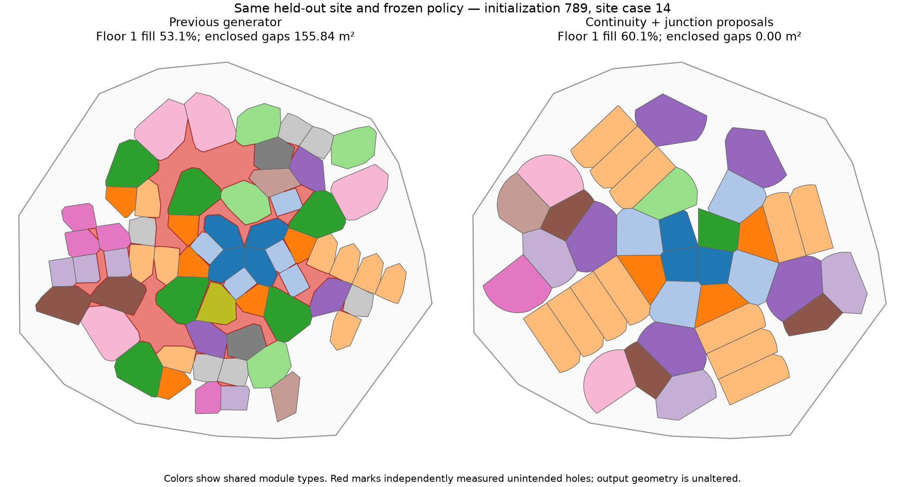

# Shared module continuity fix — 2026-11-05

Backend generation now prevents unintended enclosed gaps during construction.
It does not stretch instances, paint gaps over, add hidden filler modules, relabel
leftovers as courtyards, reject completed layouts, or prescribe a rectangular grid.
The backend and completed UI redesign are integrated and verified in the active
port8000 demo (integration commit `d5e1e7eb`).

## Implementation

- Every new convex occurrence must meet the previous construction footprint along
  one connected boundary arc on every affected floor. Disconnected contacts would
  close a loop around leftover space and are disallowed before committing.
- Shared-prototype changes preserve all existing multi-room junction witnesses,
  across every occurrence and floor. Protecting the extreme witnesses of each
  prototype is sufficient by convexity; cached support checks avoid repeating the
  same work for every vertical copy.
- Near-collinear wall fragments are combined even when a query exactly matches
  one fragment's stored key. The old fast lookup missed the other fragment and
  could overlook a point contact. The independent geometry audit tolerance was
  not loosened.
- New proposals match measured facet endpoints or sample a circumcircle through
  an existing junction. Directions/lengths come from the dictionary and continuous
  sampling, with no fixed angle grid or shape catalogue.
- Continuity uses support-line intervals/endpoints, not polygon construction or
  GEOS during training. Pose-search transactions must recertify the final implicit
  footprints. Stale or uncertified placement plans cannot overwrite the state.
- Explicit void footprints participate only in construction topology. They earn
  no occupied/rentable area or traversable access. A regression preserves a
  deliberate courtyard; no automatic voids are invented.

The current adapter is still midpoint/Voronoi-based implicit geometry. This is a
continuity fix for that model, not a claim that an abstract graph determines area
or that all future realizers share its constraints.

## Paired held-out comparison

Same frozen trained policy, seeds123/456/789,24 shared plots per seed, ANY/FREE
changing sites,4floors,120maximum/floor,target10/max15 types. The control disables
continuity/junction proposals but shares the numeric contact correction. All
failures remain in raw records. This is correctness/quality validation, not a new
learning-convergence claim.

|Variant|Original geometry + gap passes|Fill on geometry-valid layouts|Reached floor references|
|---|---:|---:|---:|
|Previous growth|0/72|44.78%|119.7|
|Continuity guard|69/72|42.23%|117.8|
|Guard + junction proposals|69/72|44.21%|122.5|

The three cases failing the pre-existing starting-core containment check are not
counted as successes. Among valid starts, the fix passed69/69; both reported and
**raw** unintended enclosed-gap area were zero. Thus this does not depend on the
0.01m² reporting threshold. Independent containment, overlap and required-contact
checks also pass. Shapes remain shared, rotation-only, and full-height footprints
remain identical. Mean type count is14.72, within the15 ceiling.

The guard alone costs fill; junction proposals recover most of it. The final
average fill is44.21% versus44.78%, not a thinned or empty-layout workaround.
An after-cache rerun reproduces all72 final outcomes, identities and poses; one
export differs by3.6e-15m in coordinates and1.2e-13degrees in one orientation. All36 dense exports are
byte-for-byte identical in their geometry fields. It was run alongside
training stress, so its wall times are not isolated speed evidence.

## Dense speed and stochastic-training checks

Speed uses L/XL,120maximum/floor,4/8floors,three seeds. Each case performs one
actual graph-only optimizer update, followed by a separately timed independent
preview of that exact graph. Previous/guard/final arms are paired and randomized.
No other agent-launched heavy tests/studies overlapped the speed batch.

|Workload|Previous rollout|Fixed rollout|Mean reached references,previous / fixed|
|---|---:|---:|---:|
|L,4floors|1.226s|1.738s|246 / 219|
|XL,4floors|2.618s|4.107s|410 / 386|
|L,8floors|2.864s|5.152s|498 / 450|
|XL,8floors|7.802s|10.526s|794 / 742|

All12 fixed dense cases passed geometry and gap checks with zero raw gap area.
Actual sizes differ, so these timings are not equal-work speedup ratios. The fix
adds work; it is not presented as a performance improvement. Caching retained all
36 dense layouts, counts and fill values exactly versus the uncached comparison.

Separately,36 stochastic ANY/FREE training cases using the observed/continuous
vocabulary route each updated policy weights exactly once, never realized during
training, and passed the independent final geometry/gap audit with zero raw gap
area. These are correctness stress runs, not proof of faster learning/convergence.

Exterior morphological crevice diagnostics remain distinct from enclosed holes.
The diagnostic is not a calibrated minimum-width architectural rule. Dense mean
crevice area fell from82.00 to64.57m² across floors; held-out mean changed from
15.82 to16.31m². The fix did not merely move the large enclosed gaps into that
metric. Ordinary exterior recesses and other architectural/program improvements
remain outside the enclosed-hole guarantee.

## Evidence and regression cases

- [Paired216-case comparison](../../benchmarks/2026-11-05-v010-continuity-quality-01/manifest.json)
- [Final cached72-case verification](../../benchmarks/2026-11-05-v010-continuity-quality-02/manifest.json)
- [Dense comparison](../../benchmarks/2026-11-05-v010-continuity-speed-02/manifest.json)
- [36 stochastic-training cases](../../benchmarks/2026-11-05-v010-continuity-training-01/manifest.json)

Tests cover a16m² ring hole, a0.67m² hole opened remotely by changing a reused
prototype, point-only contacts, four-room junctions, full-height scope, rotated
oblique motifs, explicit courtyards, stale transactions, fragmented contact
intervals, pose recertification and pooled-versus-exhaustive junction checks.
The initial diagnostic directory remains preserved: its first version left a
2.48m² hole and is explicitly superseded by the contact-fragment correction.

The picture below is a selected illustrative case (seed789,case14), not the average:
floor1 fill changes53.1%→60.1% and unintended holes155.84m²→0.00m². All source
geometry is unaltered; colors identify shared types. Full-case statistics above
include every held-out plot and the unchanged starting-core failures.

Verification:320 tests completed successfully,2 skipped. [Logs and cache equivalence](../../benchmarks/2026-11-05-v010-continuity-verification/).

## Running demo verification

The original checkout now contains the integrated backend/UI, and its idle old
daemon was replaced on port8000. The rebuilt UI serves `index-DEvDr_LW.js`.
Its existing README edits, custom-site dataset/deletion intent, user notes and
five saved checkpoint files were preserved. No remote push was made.

A fresh nine-floor UI inference run (130 maximum/floor,15-type ceiling) completed
with816 independent occurrences plus8 vertical copies,45.6% fill and passing
geometry/access checks. Inference made0 policy updates. Its measured server time
was14.18s including1.24s final geometry validation; this single live run is not a
throughput benchmark. The first tiny site exposed the existing starting-core
failure and was rejected; that limitation remains open.

A separate production-WebSocket smoke check against the same daemon generated
694 occupied floor references across9 floors,15 types, passing geometry/access
and gap checks, with zero raw unplanned enclosed-gap area on every floor.
An independent unbuffered polygon union retained its numerical interior-ring
areas: seven floors0, two floors approximately1.42e-9m² each. These are recorded
alongside the seam-aware server audit rather than discarded from the evidence.

[Live settings, final geometry, checks and reproducible client](../../benchmarks/2026-11-05-v010-continuity-live/manifest.json).
The merged frontend's18 protocol tests and production build pass. The displayed
floor remains open in the app. Exterior recesses and architectural circulation
design remain separate from preventing unintended enclosed holes.
