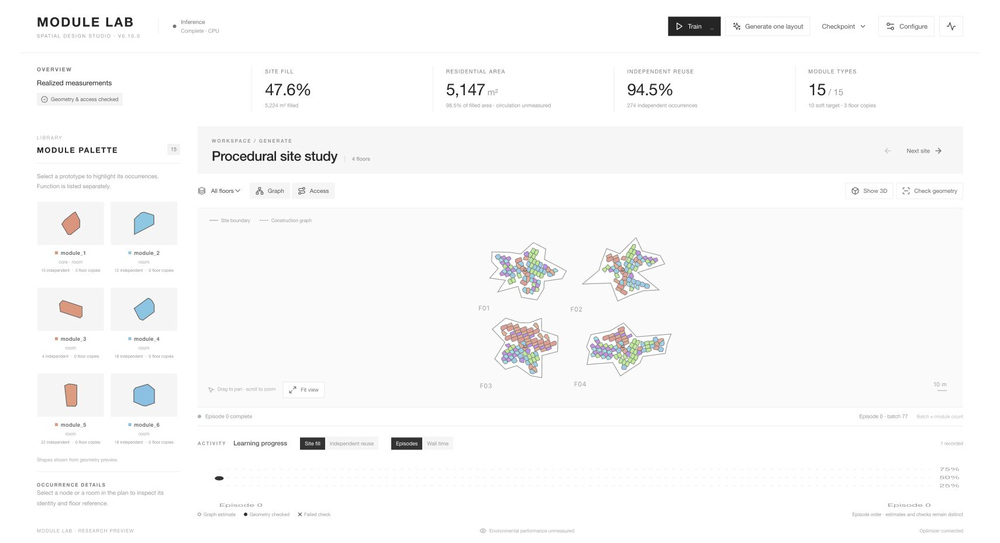
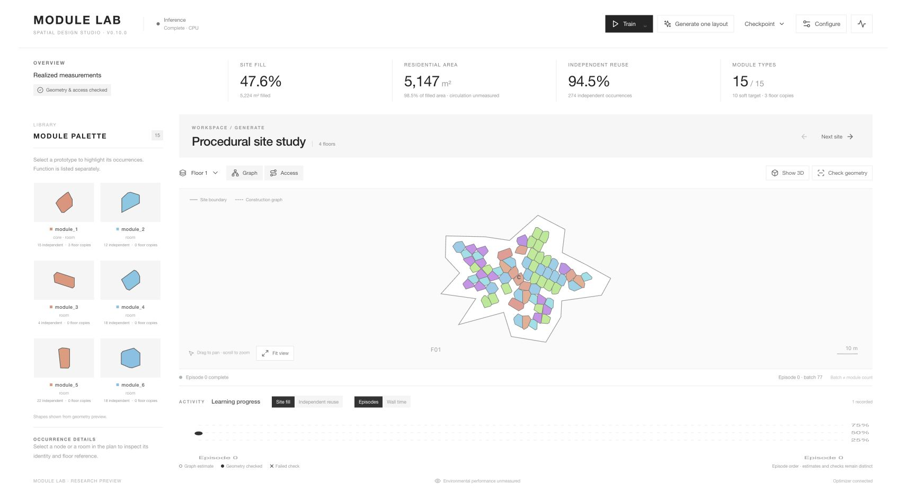
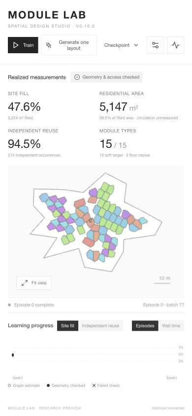

# Reference-inspired visual update — 2026-11-05

Branch: `codex/ui-overhaul`, following UI implementation `daf20eb9`.

The final direction follows the user's supplied white furniture-catalog reference: generous white space, fine dividers, compact uppercase headings, square controls, a light-gray study header, and a left module library with two columns of colored geometric thumbnails. It supersedes the intermediate Apple/glass and monochrome directions. Interface surfaces and controls stay neutral; module identity retains color across the plan, palette and 3D renderer.

`frontend/src/editorial.css` contains the visual layer over the existing responsive workspace structure. No `apple.css` remains. Typography/labels are simplified, and the module palette now presents shapes as catalog tiles. Charts retain neutral symbols (hollow estimate, solid checked, cross failed), so their states do not depend on module colors. Existing controls, data semantics, geometry and training behavior are preserved.

Both urban-renderer source copies are synchronized; prototype colors use the same stable hash and HSL parameters as the React UI. No backend source, datasets, custom-site records, generated dist, model weights or unrelated local changes belong to this commit.

Verification:

- Vite production build passed to `/tmp/module-lab-editorial-ui-build`, preserving the existing `frontend/dist` state.
- Frontend protocol/display suite: 18 tests passed.
- Backend suite: 290 tests, OK, two skipped (32.201 seconds). No backend edits.
- Browser check against Vite 3000 and the dedicated stable backend 8001: four floors, 120 max modules/floor, frozen inference completion, colored geometry, single-floor selection and framing, module thumbnails and narrow-screen layout at width 390. This is UI verification, not a performance/quality benchmark.
- The in-app browser connection was unavailable during this follow-up. Visual verification used a separate Chrome preview of the same localhost UI. The temporary viewport override was reset.
- No upstream `origin/codex/ui-overhaul` exists locally; scoped changes were reviewed against `daf20eb9`. No remote push or backend-branch merge.

Screenshots: [wide workspace](wide.jpg), [single-floor geometry](floor-detail.jpg), [narrow layout](narrow.jpg).

