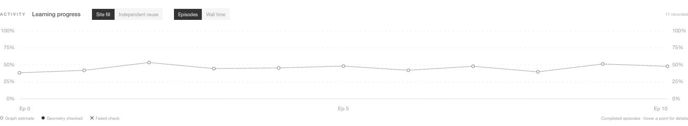

# Learning chart correction — 2026-11-05

Branch: `codex/ui-overhaul`. Follows visual update `bd3b822c`.

The old fixed 710×108 SVG was stretched into a very wide, shallow panel with `preserveAspectRatio="none"`. This distorted circular markers into ellipses, stretched labels, and compressed changes into a narrow vertical band.

The plot now measures its container width with ResizeObserver and uses matching pixel coordinates with 174 pixels of chart height. Marker size, line weight and typography remain consistent across widths. The fixed 0–100% scale is labelled on **both left and right** at 0%, 25%, 50%, 75% and 100%. Three horizontal ticks identify the first, middle and last visible episode/time. Single observations are centered. Missing values remain gaps.

Per the user's follow-up, the line connects every available result, **including failed checks**. Failure crosses remain visible, with hover text distinguishing failed geometry from a failed graph check. Historical data, recorded values and validation flags are unchanged. No smoothing or invented trend was added. Wall time is explicitly relative to the first visible completion, and unavailable timings disable that axis.

Verification: production Vite build passed to `/tmp/module-lab-chart-build`; all 18 frontend protocol/display tests passed. Live browser verification used an isolated four-floor L-site session, 120 max modules/floor, with 11 recorded episodes. Observed chart viewport: 1309×174 pixels; observed marker bounds: 5.4000×5.4000 pixels. Both copies of all five percentage labels were confirmed in the rendered SVG. This was a UI check, not a learning/performance benchmark. The user's existing browser run/history was left intact; backend source and unrelated local changes were untouched.

