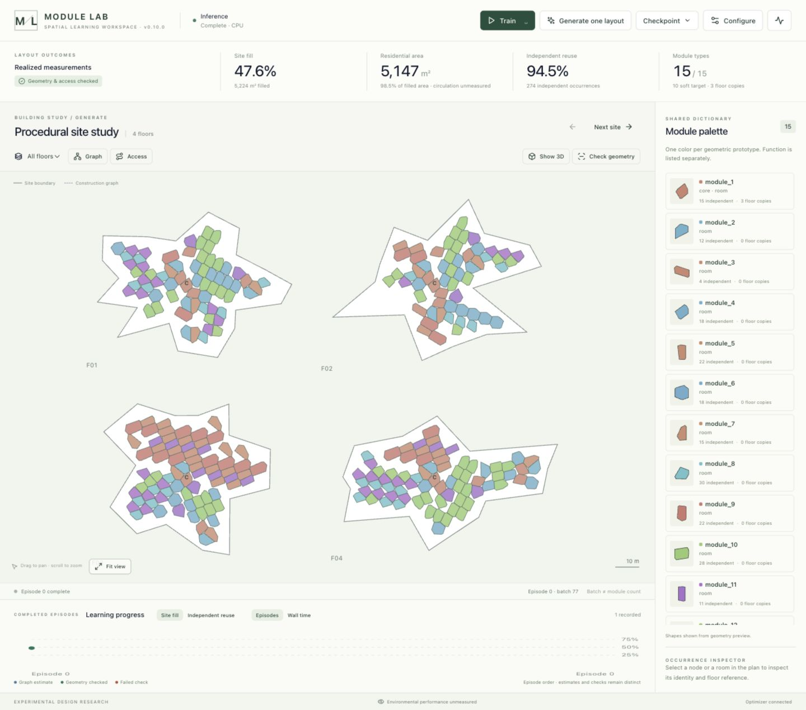
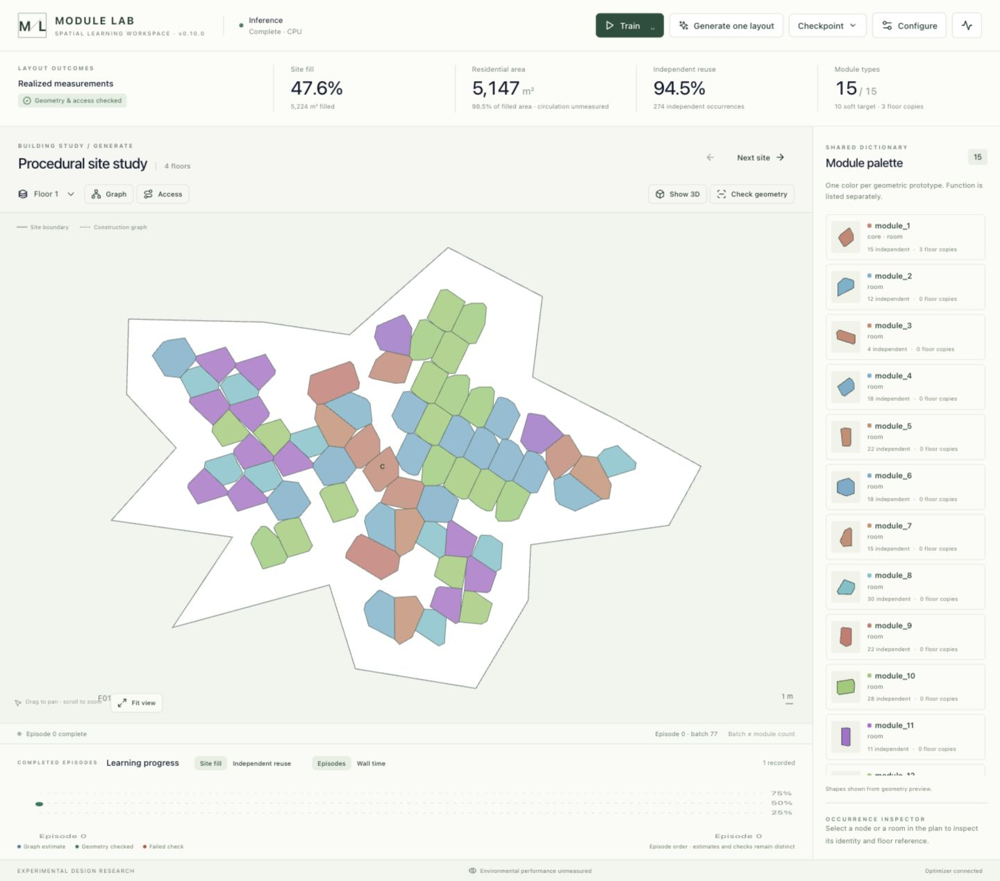
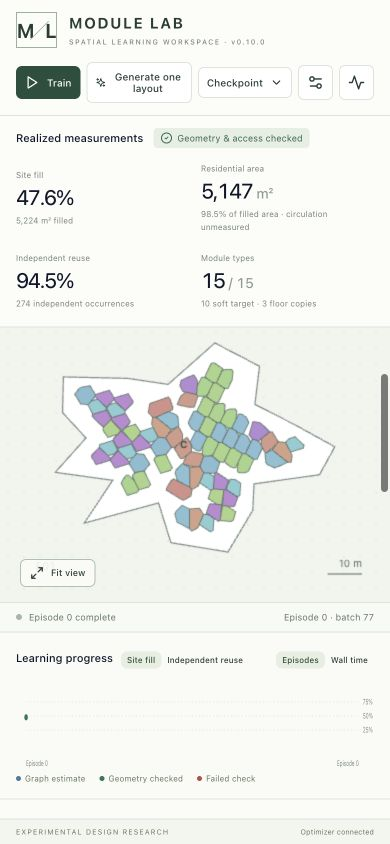

# UI overhaul delivery — 2026-11-05

Branch: `codex/ui-overhaul`. Checkout: `/Users/ruslan_faz/Desktop/Work/Thesis`.
Base: `4084bc42`. Implemented from [the handoff](../../guides/UI_OVERHAUL_HANDOFF.md) and [backend contract](../../contracts/graph_ui_v010.md).

## Delivered behavior

A plan-first workspace replaces the competing floating control deck. One action bar contains Train/Pause, Generate one layout, a checkpoint menu, Configuration and Diagnostics. Optional 3D starts frozen and keeps its iframe/camera when toggled; fitting views is distinct from resetting model weights. Floor selection, pan/zoom, module selection and a physical-occurrence inspector support dense layouts. Prototype colors are stable across the palette, plan and 3D; function labels remain separate.

The outcome strip distinguishes graph constraint estimates, independently realized measurements and failed checks. It shows filled and residential area, independent repeat fraction and type budget (soft target / hard ceiling). Circulation and environmental metrics stay unmeasured when absent. Graph-only palette entries show constraint metadata; polygon thumbnails appear only after realization. The graph overlay uses dashed construction relations; absent usable-access edges are explicitly unavailable. A construction edge is never relabelled a doorway.

Configuration edits are drafted and applied as one backend transaction. Returned site settings are authoritative. Generator/controller/proposal/architecture controls remain available, with experimental routes labelled. Urban area, city and context-height filters and the custom-site map are preserved. Legacy angle/clearance heuristics do not appear as graph rules.

Completed episode history retains graph estimates, realized checks and failures, with fill/reuse views by episode order or measured client episode wall time. Geometry preview never rewrites the historical estimate. Server episode runtime, client wall time and validation timing remain separate; missing runtime has no invented substitute. Composite score and optimizer details are secondary diagnostics.

## Protocol and geometry fixes

- Dispatch graph steps directly from WebSocket replies, independent of browser render and timer gates. Keep only one in-flight step.
- Wait for setMode acknowledgement before starting; late mode replies cannot undo pause.
- Pause waits for the current batch before one geometry preview, without scheduling another optimizer step.
- Graph inference stops after one completion, including invalid results. Preserve failed layouts and their validation.
- Drop stale generation/episode replies and replies queued during site replacement; stop on command errors instead of retrying indefinitely.
- Keep the inspected completed episode distinct from the server's next-episode number, including completed previews.
- Prefer physical graph occurrences over legacy merged display geometry. Native graph polygons use local coordinates with an explicit pose; translate them once by the floor offset. Legacy world-space display records are not translated again.
- Count independent occurrence IDs and floor references separately. Missing identity remains unknown; IDs are not parsed for fabricated counts.
- Cache iframe setup, freeze hidden rendering, replace per-node 3D badges/textures with one vertex-colored point buffer and keep the two urban renderer source copies identical.
- During Vite development, renderer scripts are served from `frontend/public` rather than a stale backend `dist` copy. Backend API, dataset and site requests still target the dedicated `127.0.0.1:8001` service.

## Verification

- `npm --prefix frontend test`: **18 passed**. Tests cover actual store transitions and display semantics, including mode acknowledgements, pause races, terminal previews, stale replies, settings transactions, invalid inference, absent timings, unchanged estimate history, independent reuse, coordinate conventions and simulated reset dispatch.
- `python3 -m unittest discover -s tests -p 'test_*.py'`: **290 tests, OK, two skipped**. Includes graph checkpoint persistence/migration and backend lifecycle checks. Existing numerical RuntimeWarnings occurred; no test failed.
- Production Vite build passed using `--outDir /tmp/module-lab-ui-build --emptyOutDir`, preserving the pre-existing `frontend/dist` changes and custom-site records.
- Browser against Vite 3000 / backend 8001: settings transaction, dense four-floor generation with 120 max/floor, single-layout inference termination, real training across changing sites, pause/preview, floor filtering, geometry visibility, graph/3D toggles, palette selection, checkpoint save and reload, and narrow-screen scrolling. A frozen valid example reached 274 independent occurrences plus three vertical copies and 15 prototypes; these are UI smoke observations, not benchmark or quality-improvement claims.
- A failed starter was retained and displayed as validation failed. Frozen successful results showed geometry/access checked. Training completion stayed labelled geometry not checked until preview.
- Browser widths 1440 and 390 were inspected. Fit view works after resizing; pan/zoom intentionally survives data updates. Drawers support Tab focus containment, Escape dismissal and focus restoration; shortcuts avoid consuming input edits or a button's native Space activation.
- The live “Yes, Reset” click was rejected by automatic approval review because it would erase training progress. The dialog was cancelled. Live weights were not reset; reset command wiring was verified with a simulated socket and existing backend tests instead.
- Compatibility renderer copies compare byte-for-byte. Backend `src/` and backend `tests/` have no diff from the base. All 12 pre-existing non-UI tracked diffs were compared with the captured starting diff and remain unchanged.

## Screenshots

[Wide workspace](wide.jpg), [single floor](floor-detail.jpg), [narrow workspace](narrow.jpg).







## Additive backend requests / limits

No backend changes are required to run this UI. Explicit physical-contact and usable-access edge payloads would permit those separate overlays; the current server does not export them. The Access control reports unavailable instead of inferring doorways. Optional `metrics.filledArea`, `rentableArea` and `circulationArea` on every live graph/preview reply would avoid unavailable area fields; preview currently falls back to audited per-floor filled area and measured residential placements. An explicit inspected-episode identifier on completed previews would remove the need to preserve it in the client.

No orthogonality slider, corridor policy, sunlight score, architectural compliance claim or learning-speed claim was added. The existing backend checkpoint migration is retained. Reset was not executed live after the approval rejection. No throughput/convergence benchmarks were run for this UI change.

## Integration

Only frontend source/config/tests, the synchronized compatibility renderer and this report/screenshots belong in the UI commit. Existing unrelated README/agent notes, datasets/custom-site records/deletions, docs and generated dist changes remain outside the commit. A pre-edit snapshot of existing UI source and the full tracked diff was retained under `/tmp/module-lab-ui-baseline` for this session. No reset, clean, stash, release merge or remote push was performed.

The backend integration agent should review/merge this branch into `version/v0.10.0`, rebuild `frontend/dist` once from merged source without replacing custom-site records, and run combined protocol/render verification. Keep the stable backend on 8001; backend experiments retain 8002/headless. Development command:

```sh
cd /Users/ruslan_faz/Desktop/Work/Thesis/frontend
MODULE_LAB_BACKEND_URL=http://127.0.0.1:8001 npm run dev -- --host 127.0.0.1 --port 3000 --strictPort
```
