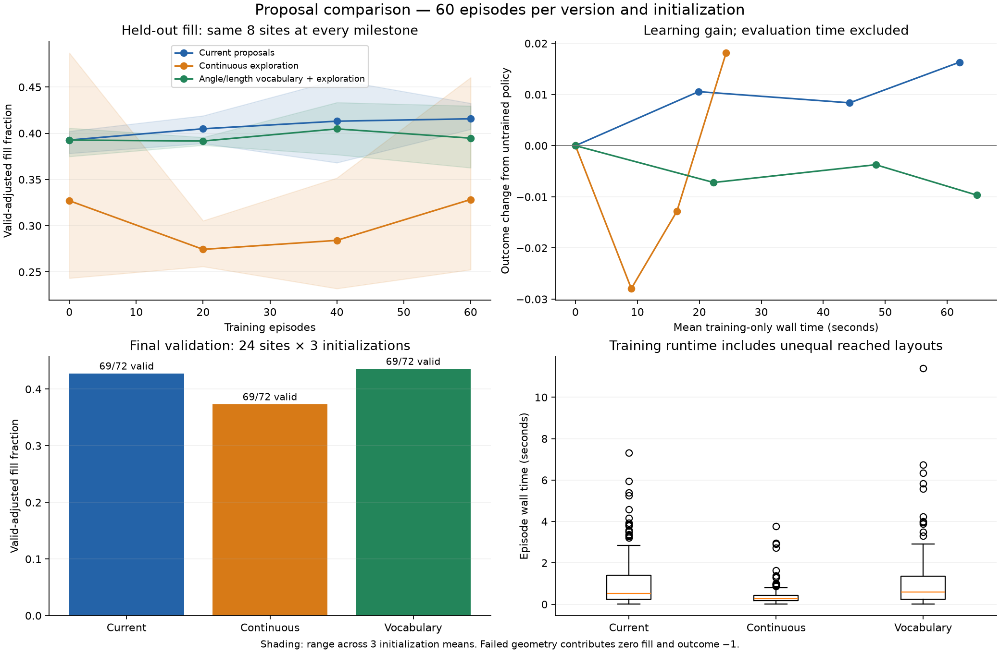

# Angle/length proposal experiment — completed 2026-11-05

The vocabulary is implemented, but this pilot does **not establish faster learning**. Keep `graphProposalStrategy=legacy` as the default. `vocabulary` and `continuous` remain explicit experimental options. Lower fill disqualifies a speed-only result.

## Corrected comparison

Three initialization seeds (123, 456, 789), three proposal versions, 60 training episodes per version/seed. All use ANY/FREE, a new site each training episode, four floors, 120 max modules/floor, target 10 / ceiling 15, the same objective and network capacity. There are 540 actual training cases and 576 frozen evaluation cases: 1,116 total. Initial/final evaluation uses 24 shared held-out sites per seed; milestones 20/40 use a fixed eight-site subset. These are pilot learning results, not convergence evidence or a production architecture assessment.

| Version | Fill on valid layouts | Valid final layouts | Mean occupied types | Independent repeat fraction | Mean training case time |
|---|---:|---:|---:|---:|---:|
| Current proposals | 44.62% | 69/72 | 14.23 | 74.67% | 1.033 s |
| Continuous exploration | 38.96% | 69/72 | 13.90 | 39.95% | 0.405 s |
| Vocabulary + mixed exploration | 45.49% | 69/72 | 11.77 | 75.73% | 1.080 s |

The repeat fraction is (N−K)/N for independent occupied occurrences; vertical copies and holes earn no fabrication reuse. Training timings include unequal reached layouts and live-desktop load. They are not matched-workload throughput ratios.

The vocabulary's mean valid-adjusted fill gain is **0.83 percentage points**, with crossed-bootstrap 95% interval **−1.13 to +2.77 points**. Its outcome difference is +0.0119, interval −0.0036 to +0.0302. Its improvement over its own untrained policy, relative to the baseline's improvement, is +0.0074, interval −0.0156 to +0.0336. These intervals include no improvement.

On the common eight-site learning curve, vocabulary gain from the untrained policy is negative in two of three seeds; the descriptive gain at equal training-only wall time does not beat the baseline. The full 24-site initial/final comparison shows a small positive mean change for the vocabulary, but does not establish faster learning. Do not confuse different site subsets between milestone plots and final validation.

The continuous-only exploratory route has lower mean fill and reuse, and inconsistent seed results. Its shorter episodes are not an efficiency win. All versions retain the same existing module-contact proposals; “continuous” describes the additional exploration route, not the removal of module reuse constraints.

All three have the same three final failures, one held-out site per seed where the initial full-height core lacks a certified placement across all floors. These failed layouts remain in the aggregate; they are not filtered out. Invalid geometry contributes outcome −1 and valid-adjusted fill zero. No execution errors occurred.

The vocabulary policy selected 457 new-angle/reused-length placements and 150 reused-angle/new-length placements across final evaluations. It also selected 201 fully learned and 4,903 observed/observed placements. This confirms that the mixed routes are exercised; it does not prove that training discovered better patterns.

Shading is the range of three initialization means, not a confidence band. The plots use the same eight sites at every milestone. Final bars use all 24 sites. Training time excludes evaluation; coarse milestone interpolation at common time is descriptive.

## Implementation and corrections

The per-building vocabulary records actual lengths and every directed pairwise turn in each star. Pairwise turns include sums of consecutive turns modulo 2pi. It supplies independent angle/length combinations, alongside observed module-contact transformations. No spatial pattern catalogue or angular/length grid is prescribed.

A trainable continuous head emits distributions over relative angle and length. The vocabulary route can reuse either factor while generating the other. Fixed factors receive no continuous-density gradient credit. The final categorical actor chooses among compatible proposals. Physical transformed-distribution entropy includes Jacobians; a large latent variance cannot earn entropy merely by saturating the angle transform. Old schema-1/2 checkpoints migrate to schema 3 while preserving old logits and Adam moments; new head parameters start fresh.

The first 1,116-case pass is retained as `2026-11-04-v010-angle-study-01` but superseded. It exposed duplicate near-parallel support rows that could count one facet several times, inflate area, and inconsistently reject a real contact. A replay had implicit contact 0 while independent geometry measured approximately 1.56 m. The corrected solver retains the strongest parallel bound, handles numeric contact aliases and keeps the independent oracle's overlap/contact tolerances unchanged. A millimetre-gap regression prevents treating material differences as numeric aliases.

The first pass also credited proposal draws when an already invalid starter made every growth action illegal under the current certificate. Those states now retain failure but produce no unrelated policy update. The origin-search result explicitly distinguishes an uncertified starter from a ready one. This is not proof that the site itself is infeasible.

Active prior half-spaces are cached: adding constraints cannot reactivate a previously redundant inequality. Unchanged requirements are not revalidated repeatedly. No room polygons or polygon Boolean operations are constructed during training. Inference/preview still validates separately.

## Evidence and limits

Raw data, complete source snapshots/hashes, seeds, settings, source-selection counts, checkpoints, site fingerprints and failed layouts are in `../benchmarks/2026-11-04-v010-angle-study-02/`. `analysis.json` and the copied analysis runner preserve the crossed bootstrap and common-time summaries. The pre-correction study, smoke runs, profiles and timing diagnostics remain separately identified. Maximum absolute held-out filled-area prediction errors are about 0.000013 m² (baseline), 0.0000011 m² (vocabulary), and below 0.000000001 m² (continuous), for this selected convex model; these are not general architectural/environmental accuracy claims.

Recent L/XL four-floor records and a same-session pinned runtime reference are diagnostics. A complete corrected 4/8-floor matched throughput comparison is not established here; no throughput speedup is claimed. Earlier fast-runtime records refer to earlier source snapshots, including the subsequently corrected facet problem.

After the frozen study, additive UI telemetry exposes occurrenceId, scope and a top-level reuseAudit. These exports do not change proposals, objectives, optimizer behavior or learned parameters. All 290 tests pass (two skipped); the six vocabulary/migration tests also pass with a self-contained real schema-2 fixture, without requiring Git history. The localhost UI-origin WebSocket check returns valid frozen geometry and zero updates. A clean frontend build passes. Protocol evidence is retained alongside the release records. The new planning hypotheses and UI brief are separate proposals, not implemented features.

## Decision

Keep the current proposal strategy as default. Keep the vocabulary available for further controlled work. Prioritize boundary/goal-conditioned learning, adaptive proposal ranking, local repair, explicit circulation and a soft prototype-corner preference before declaring an improved architectural policy. See [the hypotheses](../guides/algorithm_hypotheses_2026-11-05.md). No new architecture or proposal strategy is promoted by this pilot.
