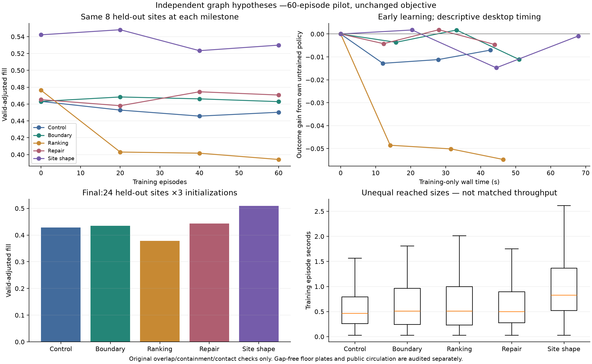

# Individual hypothesis benchmarks — 2026-11-05

**Decision: do not promote a generator variant as an architectural improvement.**
The user's screenshot exposed a missing requirement: continuous floor plates.
Of 72 baseline held-out cases, 69 passed the original overlap/containment/contact
checks, but **zero passed those checks plus the new enclosed-gap check**. Better
fill alone is not success. Public circulation is also not established by ordinary
room-through-room reachability.

The experimental variants remain opt-in Python research hooks. The default
proposal strategy is unchanged. No fixed-angle graph reward, rectangular-grid
generator, per-instance shape stretching, or production checkpoint replacement
was introduced.

## Scope and evidence

- Quality: 1,860 cases, including 900 training episodes. Five arms × three seeds;
  60 training episodes per arm/seed; ANY/FREE changing sites, four floors, 120
  maximum occurrences/floor, target10/max15 types. Initial/final24 held-out plots,
  intermediate8 common plots. This is a pilot, not 750-episode convergence.
- Speed: 60 graph-training episodes and separately timed audits of those exact
  graphs; L/XL, 120 maximum/floor, four/eight floors, three seeds. Trained pilot
  checkpoints, randomized arm order. Actual reached sizes are retained.
- Geometry: 72 held-out frozen baseline layouts plus12 L/XL baseline layouts;
  shared orthogonal cuts, midpoint reconstruction, oracle wall-port reconstruction,
  public-circulation assignment. No policy updates.
- Alternatives: three additional frozen categorical samples for each of72 cases
  (216 extra rollouts), same reward and checks.
- Urban supplement:60 frozen cases, four untouched irregular plots ×five arms
  ×three seeds, selected by fixed hash/geometry before outcomes. No training.
- Gap audit:696 final frozen layouts, added **post hoc** after the user's image.
  Original raw metrics remain unchanged.
- Corrected live endgame repair:12 authoritative in-memory L/XL graphs, four/eight
  floors, 72 trials; independent validation after repair. Separate from the earlier
  repair pilot and its acceptance surrogate.

Primary studies completed without execution errors. The superseded replay-repair
diagnostics retain their reconstruction failures; see the raw directories below.
All settings, revisions, source snapshots/hashes, seeds, checkpoints, failures and
raw records are preserved. No remote push was performed.

## Generation variants

Values below are **exact ratio-of-floor-area-sums fill**, averaged across held-out
buildings; failed original geometry checks contribute zero. They are not adjusted
for the newly detected gap failures. Crossed95% intervals resample initialization
seeds and common plots. Three seeds and multiple exploratory comparisons limit
inference.

| Arm | Check-adjusted fill | Difference from control | Crossed95% difference | Pass geometry + enclosed-gap check |
|---|---:|---:|---:|---:|
| Control |42.84%|—|—|0/72|
| Boundary context |43.49%|+0.64pp|−0.86 to+2.24pp|4/72|
| Feasibility ranking + four-plan quota |37.80%|−5.05pp|−10.81 to+2.29pp|0/72|
| Early bounded repair pilot |44.31%|+1.46pp|−2.45 to+4.97pp|1/72|
| Shape-specific site certificate |50.90%|+8.05pp|+5.71 to+10.54pp|0/72|

All arms passed original geometry checks in69/72 cases. The same three initial
full-height origin failures were retained. No arm demonstrated faster learning
relative to its own untrained policy. Much of the site-certificate benefit is
already present without training: it permits valid perimeter placements that the
radius certificate unnecessarily rejects.

The boundary prototype supplies measured descriptors to pooled actor/critic
context. Goals are fixed in this study; varied-budget conditioning and stronger
candidate-local boundary attention were not established. The ranking prototype
learns feasibility, not marginal layout value; shrinking its feasible choice pool
lost fill. This does not disprove every possible proposal ranker.

The first repair pilot used a building-wide score surrogate for acceptance,
whereas the actual terminal reward averages per-floor nonlinear scores. It also
spent its six-trial budget early. Its observed fill difference is inconclusive
and must not be represented as validation of the corrected repair implementation.
The selector now uses the actual per-floor objective; see the matched endgame test.

## Speed and local repair

Control graph rollout means, excluding setup and independent realization:

| Workload | Rollout seconds | Mean reached floor references | Configured maximum |
|---|---:|---:|---:|
| L,4floors |1.129|235|480|
| XL,4floors |2.820|403|480|
| L,8floors |2.757|481|960|
| XL,8floors |6.842|785|960|

These are headless desktop measurements, not UI latency or hardware peak claims.
Different variants reached different sizes/fills, so episode-time ratios are not
equal-work speedups. The quality pilot's descriptive wall times also include a
unit-suite overlap in its first initialization; the separate speed batch is the
performance evidence.

The corrected live endgame test used the real in-memory dictionaries, including
one case reaching960 floor references. Six trials cost **0.213s on average,
0.446s maximum** across12 cases. **Zero of72 trials improved the exact objective;
fill gain was zero.** All12 retained original geometric validity and all12 still
failed the enclosed-gap criterion. This bounded random-pose repair is not worth
enabling. It is not evidence against a targeted junction repair or a learned
repair operator, which would need its own measured trial.

## Geometry, circulation and alternatives

- **90-degree realization:** the conservative shared-cut adapter improved mean
  prototype right-corner fraction by1.76pp while losing0.326% of filled area at a
  2% per-prototype loss budget. At10%, the changes were+2.51pp and−1.341% area.
  Required contacts survived in69/69 originally valid cases. These cuts only
  remove material: they cannot fill the reported holes. Keep orthogonality in
  realization, not an incident-edge graph reward.
- **Contact ports:** oracle wall evidence and midpoint reconstruction both passed
 69/69 original geometry checks. A rotated oblique-room/long-corridor fixture
 demonstrates a capability midpoint bisectors lack. The port evidence comes from
 reference geometry: no trained port predictor or generated-quality gain was
 demonstrated. Mean solve times on the proper L/XL frozen workload were0.0030s
 for oracle ports and0.0067s for midpoint reconstruction, excluding evidence
 extraction/validation. This is not an end-to-end speedup comparison.
- **Public circulation:** the post-layout connected-corridor assignment passed
 the selected65% residential program in0/69 cases; mean residential share was
49.44%. It assumes each remaining module occurrence is one private unit. The
 threshold is an experimental setting, not a user-approved architectural rule.
 Functions are atomic across full-height occurrences. Candidate door contacts
 use the configured0.5m contact threshold; actual door design is not verified.
- **Alternatives archive:** best-of-four increased the original mean-floor,
 geometry-check-adjusted fill from42.85% to45.14%, spending about4.02× inference
 time. Near-best coarse topology descriptors averaged1.71. None of the216 extra
 layouts passed the geometry-plus-enclosed-gap criterion. This does not deliver
 acceptable architectural alternatives yet.
- **Urban supplement:** original check-adjusted fill was39.70% control,36.62%
 boundary,31.63% ranking,40.48% early repair and44.21% site certificate. The
 geometry-plus-gap pass counts were2/12,3/12,1/12,3/12,1/12 respectively. Four
 sites are a limited supplement, not generalization proof.

## Gap and fill corrections

The independent gap audit exempts only explicit site holes/void footprints. It
does not change actual polygons, credited areas, or original raw validity fields.
An unplanned enclosed hole over0.01m² fails its criterion; a separate exterior
crevice diagnostic is not yet a calibrated hard rule. Baseline originally valid
held-out buildings averaged106.26m² of enclosed unplanned gaps **summed across
their four floors**. See [the diagnosis](../guides/unplanned_gaps_2026-11-05.md).

Live graph training, preview and inference now use **exact net site polygon area**,
not legacy raster-cell counts. Reported building fill is occupied footprint area
summed across floors divided by net plot area summed across floors. Independent
benchmark helpers now use the same aggregation and retain mean-floor fill as a
separate statistic. The original study's raw mean-floor values are preserved;
`derived_exact_fill.jsonl` supplies exact weighted/gross/residential coverage.
This accounting correction happened after the controlled batch; its results are
not a convergence evaluation of newly trained policies using the corrected input.

Preview/inference validation now adds `spatialQuality` and the preview metrics
expose `continuousFloorPlateValid`/unplanned gap area. Original `validation.valid`
retains its geometry-only contract. Gap avoidance is **not yet learned or enforced
in graph growth**; the generator itself is not fixed by detecting its failures.

## Next decision

Prioritize shared-contact endpoint/interior-junction closure and explicit designed
voids before corner styling, more training, or generic random repair. Keep reused
shapes rigid and count any extra fabrication types. A final geometry gap check is
required; benchmark a cached local graph/port proxy before adding it at every
training action. Do not fill each occurrence independently or relabel leftover
holes as courtyards to make the score look better.

## Raw evidence

- [Quality and learning](../benchmarks/2026-11-05-v010-hypotheses-quality-01/manifest.json)
- [L/XL speed](../benchmarks/2026-11-05-v010-hypotheses-speed-01/manifest.json)
- [Frozen geometry](../benchmarks/2026-11-05-v010-hypotheses-frozen-quality-01/manifest.json)
- [Frozen L/XL geometry timing](../benchmarks/2026-11-05-v010-hypotheses-frozen-speed-01/manifest.json)
- [Alternatives](../benchmarks/2026-11-05-v010-hypotheses-archive-01/manifest.json)
- [Urban supplement](../benchmarks/2026-11-05-v010-hypotheses-urban-01/manifest.json)
- [Post-hoc gap audit](../benchmarks/2026-11-05-v010-hypotheses-gap-audit-01/summary.json)
- [Authoritative live endgame repair](../benchmarks/2026-11-05-v010-live-endgame-repair-01/manifest.json)
- [Earlier replay diagnostic01](../benchmarks/2026-11-05-v010-endgame-repair-01/manifest.json)
- [Earlier replay diagnostic02](../benchmarks/2026-11-05-v010-endgame-repair-02/manifest.json)

## Verification

Native C built;310 unit tests completed successfully,2 skipped. Graph-only training
continues to avoid polygon realization/gap auditing; previews expose exact-area and
spatialQuality fields. [Logs](../benchmarks/2026-11-05-v010-hypotheses-verification/).
No frontend source/assets or user dataset records were changed in this worktree.
