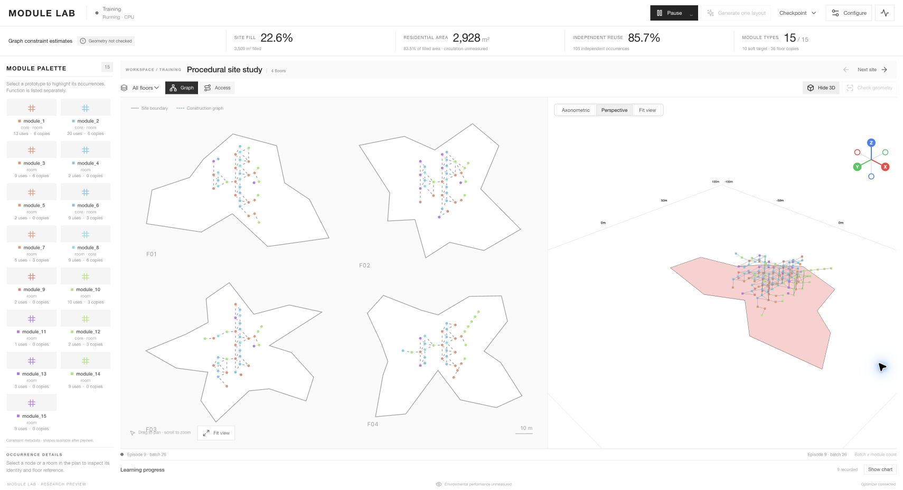
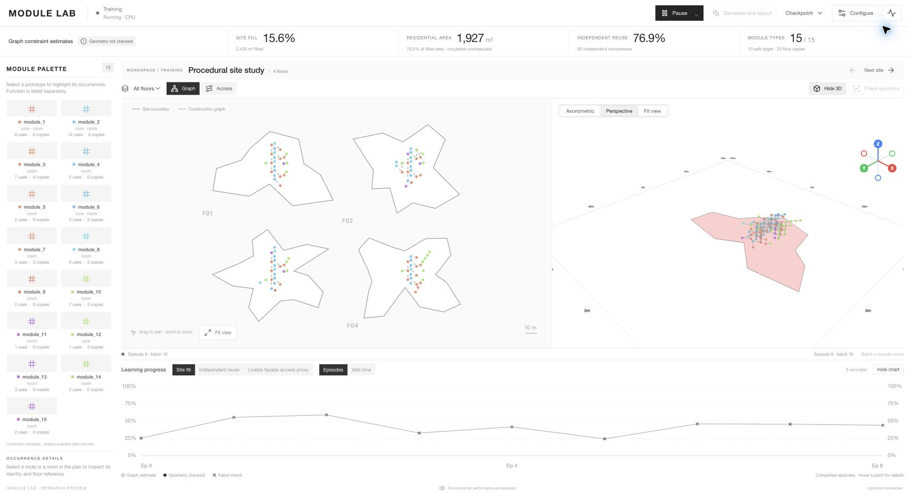

# Canvas-first workspace sizing — 2026-11-05

Branch: `codex/ui-overhaul`. Final changes reviewed against integrated base `8de3ed72`.

The plan and optional 3D surfaces now use the full available width, with substantially smaller header, outcome strip, study title, toolbars and footer. Removed the old 1640px maximum width. The palette is narrower (202px on desktop) and its thumbnails shrink from 74px to 32px, with tighter spacing and compact usage labels. Hover text retains the distinction between independent occurrences and vertical floor copies.

Learning progress is collapsed by default to a single heading row with a Show chart control. Its complete 174px plot remains available through Show chart / Hide chart, with both percentage axes, failed-check connections and the newly integrated exposure metric unchanged. Chart toggling fits the 2D plan to its changed viewport; graph messages still preserve user framing. The 3D viewer mounts on first opening at its visible size, then remains mounted across later hide/show toggles.

Measured browser layout:

- At 1710×985: working surfaces 1470×722.6, **63.1% of screen area**, chart hidden.
- At 1710×929: working surfaces 1470×666.6, **61.7%**, chart hidden.
- At 1710×929 with chart expanded: 1470×471.1, **43.6%**.
- All **15 module cards fully visible** without palette scrolling after the final density adjustment.

Build passed to `/tmp/module-lab-large-workspace-build`, preserving existing dist changes. All 20 frontend protocol/display tests passed. Browser verification confirmed 2D/3D display, dense colored modules, chart open/close and the integrated exposure controls. These are UI observations, not speed or quality benchmarks.

Another agent updated this same checkout during verification, including chart exposure controls and active-time semantics. A transient stash conflict was resolved in the shared checkout; the final chart preserves those additions together with the new collapse control. No conflict markers remain. Backend code, datasets, weights and unrelated local edits were not changed by this sizing task.

The dedicated backend on 8001 was stale relative to the other agent's new frontend defaults (`graphCoreCapacity` was rejected). Verification therefore used a separate Vite preview at 3001 against the updated backend on 8000. The port-3000/8001 proxy configuration was left unchanged. Integration should keep the frontend and running backend revision aligned.

Screenshots: [large plan and 3D workspace](large-views.jpg), [expanded learning chart](with-chart.jpg).

